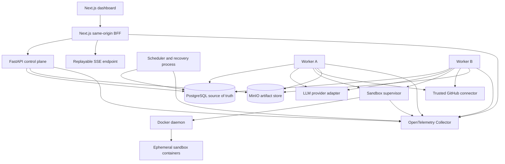
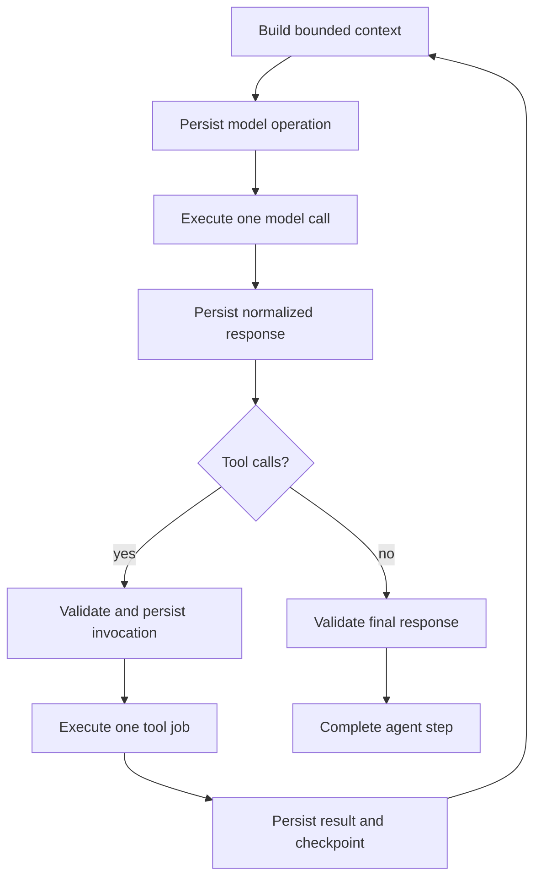

# Continuum — Authoritative Implementation Plan

**Document status:** Approved implementation specification  
**Audience:** Engineering agents and human contributors  
**Last updated:** 2026-09-10  
**Decision authority:** This document is the source of truth until a superseding ADR changes a decision.  
**Project mode:** Portfolio-quality educational system designed to evolve into an open-source project; not represented as production-ready.

---

## 1. Executive summary

Continuum is a small durable execution engine for long-running, tool-using AI agents. It demonstrates how workflow state, retries, timers, approvals, worker ownership, agent turns, artifacts, and external side effects can survive process failure without pretending that arbitrary distributed side effects execute exactly once.

The canonical demonstration is a software-engineering workflow against a controlled GitHub repository:

1. Register a repository and issue/task.
2. Clone a pinned revision into an isolated workspace.
3. Inspect and plan.
4. Modify files through typed tools.
5. Run tests.
6. Ask for human approval before any remote write.
7. If changes are requested, durably resume with reviewer feedback, revise, and retest.
8. Create a deterministic commit, push a managed branch, and open or reconcile a pull request.
9. Evaluate the result and complete the workflow.

During the demo, workers are killed, jobs are redelivered, leases expire, stale workers return, APIs emit transient failures, and the pull-request operation is replayed. Continuum must recover and must not create a second logical pull request.

### 1.1 One-sentence pitch

> Continuum runs long-lived AI agents that survive crashes, wait safely for human approval, retry failed tools, and resume without duplicating protected irreversible side effects.

### 1.2 Technical identity

Continuum is deliberately a constrained combination of:

- a durable workflow state machine;
- a PostgreSQL-backed job system;
- an agent runtime with persisted turns;
- a controlled Docker execution layer;
- a typed tool host, with MCP added later as an adapter;
- an approval and reconciliation system;
- an observability and fault-injection platform.

Continuum does **not** claim to rebuild Temporal. It implements a deliberately limited subset of durable-execution concepts so those concepts can be understood, tested, measured, and explained.

---

## 2. Confirmed product decisions

The following user-approved defaults are binding.

| Topic | Decision |
|---|---|
| Primary objective | Portfolio/learning quality with a clean path to open source |
| Initial users | One trusted local developer in P0 |
| Data model | Organization-scoped from the beginning; secure public multi-tenancy is deferred |
| Delivery shape | Approximately 16 weeks for P0, followed by optional P1/P2 work |
| Required environment | Docker Compose locally |
| Reference deployment | Optional deployment to one Linux VM; no Kubernetes in P0 |
| GitHub authentication | Fine-grained PAT locally; GitHub App in P1 |
| LLM support | Provider-neutral internal contract, one real provider first, deterministic fake provider for CI |
| Initial real provider | OpenAI, unless credentials are unavailable when the adapter milestone begins |
| Frontend | Functional engineering dashboard first; visual polish after correctness |
| P0 authentication | Development bearer token mapped server-side to one principal and organization |
| Canonical repository | Dedicated controlled fixture/demo repository |
| Development host | macOS supported; Linux containers and Linux CI are authoritative for runtime behavior |
| P0 workflow control flow | Sequential dependencies, durable waits, bounded approval rework, and simple fan-out/join |
| Generic conditional expressions | P1 |
| MCP | P1, after native typed tools work |
| Temporal | Separate follow-up experiment after Continuum is complete and measured |
| License | Apache-2.0 unless explicitly changed before public release |
| Planning source | This single plan; detailed docs and ADRs are produced during Phase 0 |

---

## 3. First-principles design basis

### 3.1 Fundamental constraints

These are not optional architecture preferences:

1. A process can die at any instruction boundary.
2. Networks can delay, duplicate, reorder, or lose communication.
3. A remote service can commit an operation even when the caller never receives the response.
4. PostgreSQL and GitHub cannot participate in one atomic transaction.
5. Human waits may last much longer than any worker process lifetime.
6. LLM responses are nondeterministic and can be malformed.
7. Agent-provided commands and repository content are untrusted data.
8. A worker that once owned a job can continue running after its ownership expires.
9. Durable state requires stable storage; no application design survives destruction of every authoritative storage volume.
10. Docker containment reduces accidental risk but is not a hardened hostile multi-tenant boundary.

### 3.2 Design choices, not laws

The following are selected because they best serve the project, not because every workflow engine must use them:

- PostgreSQL as both state store and durable queue.
- Declarative, immutable workflow definitions rather than arbitrary Python workflows.
- Materialized current state plus append-only audit history rather than pure event sourcing.
- Polling for correctness, with PostgreSQL notifications only as latency hints.
- SSE rather than WebSockets for persisted server-to-client updates.
- Docker rather than microVMs for P0 containment.
- A modular monolith with separate process roles rather than microservices.
- One model provider adapter first rather than shallow support for many providers.
- Native typed tools before MCP.

### 3.3 Minimal correctness model

The smallest architecture satisfying the objective is:

- one authoritative PostgreSQL database;
- immutable workflow definitions;
- short database transactions that transition state and enqueue the next durable work atomically;
- leased jobs claimed by stateless workers;
- fencing tokens on heartbeats and completion;
- one external operation per durable execution job;
- durable checkpoints between model calls and tool calls;
- immutable object artifacts uploaded before database references are committed;
- reconciliation for external writes whose outcomes can become uncertain.

Redis, Kafka, Kubernetes, Raft, custom consensus, and a general workflow programming language are not required to prove the project thesis and are excluded from P0.

---

## 4. Goals, success criteria, and non-goals

### 4.1 P0 goals

P0 must prove all of the following:

- API and worker restarts do not lose committed workflow state.
- Multiple workers safely compete for jobs.
- Expired leases are recovered automatically.
- A stale worker cannot commit after a newer worker has reclaimed the job.
- Retryable failures use bounded exponential backoff with jitter.
- permanently failing work becomes inspectable dead-letter work.
- timers and approvals consume no worker while waiting.
- cancellation prevents newly scheduled work and cooperatively terminates active work.
- agent execution resumes from persisted model/tool checkpoints.
- commands execute in restricted Docker containers rather than on the host.
- remote GitHub writes require approval.
- a crash after GitHub creates a pull request is reconciled without creating a second logical PR.
- event history, traces, metrics, structured logs, and artifacts explain what happened.
- seeded chaos scenarios reproduce the key failure modes.
- a naive in-memory baseline and Continuum are measured under the same scripted workload.

### 4.2 Success criteria

The release is successful when:

1. The canonical demo completes end-to-end.
2. Every invariant in Section 20 has an automated test.
3. Mandatory CI uses no paid or nondeterministic LLM calls.
4. A worker can be `SIGKILL`ed at documented failpoints and the run reaches a correct terminal state after dependencies recover.
5. The stale worker test demonstrates a rejected fenced update.
6. The GitHub unknown-outcome test observes one PR after repeated execution.
7. A fresh contributor can start the local stack and execute the scripted demo using documented commands.
8. Benchmark results include raw data, hardware, software versions, workload, configuration, and limitations.
9. Documentation clearly distinguishes guaranteed behavior from best-effort behavior.

### 4.3 Explicit non-goals for P0

- Public SaaS or hostile multi-tenancy.
- Strong isolation against Docker or kernel escape.
- High availability across regions or loss of all storage volumes.
- Kubernetes, autoscaling, remote worker fleets, or an operator.
- Exactly-once execution of arbitrary external effects.
- Automatic PR merge or production deployment.
- Arbitrary cyclic workflow graphs or user-authored code expressions.
- General compensation/saga language.
- Multi-agent collaboration.
- Browser automation.
- Dynamic user-supplied sandbox images.
- Unrestricted package installation or unrestricted network access.
- MCP, GitHub App installation flows, or Temporal integration.
- Billing, marketplace, enterprise SSO, long-term compliance, or custom cryptography.
- Model token streaming; only persisted operational events are streamed.

---

## 5. Guarantees and durability boundary

### 5.1 Guarantees

Given that PostgreSQL, MinIO, and their persistent volumes remain available, Continuum P0 guarantees:

- committed workflow, run, step, attempt, approval, timer, event, and external-operation metadata survives application process restarts;
- jobs are delivered at least once until they complete, are cancelled, or exhaust policy;
- only the current lease owner and fencing generation may commit a job result;
- state transition, audit event, and directly caused next-job creation occur in one PostgreSQL transaction;
- durable waits do not require a live Python coroutine or occupied worker;
- terminal run and step states are immutable;
- SSE events can be replayed from the committed event sequence;
- immutable artifacts referenced by committed database rows have verified SHA-256 digests;
- each external write is classified as natively idempotent, reconcilable, or explicitly capable of an unknown outcome.

### 5.2 Non-guarantees

Continuum does not guarantee:

- that an activity function executes only once;
- that an LLM request is billed only once;
- that cancellation instantly stops a remote request already accepted by another system;
- rollback of an already completed external mutation;
- identical LLM output after retry;
- durability of uncheckpointed process memory, container processes, build caches, or temporary files;
- survival of simultaneous destruction of PostgreSQL and MinIO data;
- strong hostile-code isolation from Docker alone.

### 5.3 Delivery semantics

The official wording is:

> Continuum provides at-least-once activity execution, fenced authoritative completion, and idempotent or reconciled business effects where the external system permits it.

The words “exactly once” must not be used for general activity execution.

---

## 6. System architecture

### 6.1 Architectural style

Use a **modular monolith with separately deployable process roles**. All Python roles import the same domain/application package and use the same versioned database schema. This avoids distributed-service complexity while preserving explicit control-plane and execution-plane boundaries.

### 6.2 Components



### 6.3 Process responsibilities

#### Next.js web/BFF

- Presents runs, graphs, events, steps, attempts, approvals, artifacts, workers, and DLQ.
- Holds the development API credential server-side.
- Proxies API calls and SSE without exposing bearer tokens in browser URLs.
- Contains no workflow correctness logic.

#### FastAPI control plane

- Authenticates the development principal.
- Derives organization identity server-side.
- Creates immutable workflow versions and runs.
- Queries state and events.
- Accepts approval, cancellation, retry, and DLQ commands.
- Authorizes artifact downloads.
- Performs short PostgreSQL transactions only.
- Never executes an agent, shell command, model request, or GitHub mutation inline.

#### Scheduler/recovery process

- Advances runs after state changes.
- Resolves dependencies and joins.
- Creates step instances and execution jobs idempotently.
- Fires due timers.
- Expires approvals.
- Reclaims expired job leases.
- Derives workflow-level status.
- Can run multiple replicas; correctness does not depend on leader election.
- Polls PostgreSQL for correctness. `LISTEN/NOTIFY` is permitted only as a wake-up hint.

#### Worker process

- Registers and heartbeats worker presence.
- Claims one eligible job in a short transaction.
- Executes one bounded operation outside a database transaction.
- Renews leases during long operations.
- Commits a result only after validating owner and lease generation.
- Handles model calls, typed tools, checkpointing, artifact writes, and trusted connectors.
- Does not decide dependency readiness independently.

#### Sandbox supervisor

- Is the only Continuum process with Docker daemon access.
- Accepts a narrow, authenticated local protocol from workers.
- Allows only approved image digests and fixed resource profiles.
- Creates, monitors, and terminates containers.
- Rejects arbitrary mounts, privileged mode, Docker socket mounts, host networking, and unapproved environment variables.
- Returns bounded structured execution results.

The supervisor is a security boundary for least privilege, not a claim that Docker is hostile-code-safe. The API and web processes never receive Docker access.

#### PostgreSQL

Authoritative for:

- organization identity and scoping;
- definitions and immutable versions;
- runs, steps, dependencies, iterations, and attempts;
- durable jobs, leases, and retries;
- timers and approvals;
- agent sessions, turns, model calls, and tool invocations;
- external operations and idempotency;
- append-only events and current state;
- worker registrations and artifact metadata.

#### MinIO/S3-compatible store

Stores immutable large data:

- base repository snapshots;
- workspace checkpoints;
- patches and diffs;
- full command output;
- test reports;
- generated files;
- benchmark and chaos results.

PostgreSQL stores metadata and object references, not large blobs.

### 6.4 Control plane versus execution plane

| Concern | Control plane | Execution plane |
|---|---|---|
| User/API authentication | Yes | Receives internal service identity only |
| Create/query/cancel runs | Yes | Enforces cancellation while working |
| Approval decisions | Yes | Executes only approved operation |
| Workflow state decisions | Commands scheduler advancement | Scheduler is authoritative executor |
| Job claiming | No | Worker |
| Leases and fencing | Query/display | Worker and recovery process |
| Model/tool execution | No | Worker |
| Docker lifecycle | No | Sandbox supervisor |
| GitHub side effects | Request/display | Trusted connector through worker |

A control-plane restart must not interrupt committed execution. An execution-plane restart must not lose control-plane state.

---

## 7. Technology decisions

### 7.1 Selected stack

| Layer | Decision |
|---|---|
| Backend language | Python 3.13 |
| Dependency/project manager | `uv` with locked dependencies |
| HTTP API | FastAPI and Pydantic v2 |
| ORM | SQLAlchemy 2.x async APIs |
| PostgreSQL driver | psycopg 3 async |
| Migrations | Alembic; explicit migration command, never implicit production startup migration |
| Database | PostgreSQL 17 |
| IDs | Application-generated UUIDv4; ordering uses timestamps and explicit sequences |
| JSON | JSONB for bounded structured payloads only |
| Object storage | MinIO locally; S3-compatible interface |
| Frontend runtime | Node.js 24 LTS |
| Frontend | Next.js with React and TypeScript |
| Frontend package manager | pnpm with lockfile |
| Styling | Tailwind CSS plus accessible headless components; no large proprietary UI kit |
| Backend lint/format | Ruff |
| Backend type checking | Pyright strict for application code |
| Backend tests | pytest, pytest-asyncio, Hypothesis |
| Frontend tests | Vitest and Testing Library; Playwright for end-to-end UI smoke tests |
| Containers | Docker and Docker Compose |
| Telemetry | OpenTelemetry SDKs and Collector |
| Local telemetry backend | Optional Grafana LGTM-compatible Compose profile |
| CI | GitHub Actions on Linux |
| Load generation | Locust, because workload orchestration is Python-native |
| API schema | OpenAPI generated by FastAPI and checked into CI artifact/documentation |

Exact patch versions must be pinned in lockfiles during scaffolding. If a selected major version is unsupported by a required dependency at implementation time, an ADR records the compatible substitution; agents must not silently change the stack.

### 7.2 Rejected alternatives

| Alternative | Why rejected for P0 |
|---|---|
| Redis queue/Celery | Hides the queue durability and lease mechanics this project exists to implement |
| Kafka | Operationally excessive; does not remove the need for workflow state and external reconciliation |
| Temporal | Deliberately deferred until after implementing and measuring the constrained runtime |
| Pure event sourcing | Adds replay/schema-evolution burden without improving the P0 learning objective |
| Microservices | Adds network and deployment failure modes before module boundaries are stable |
| WebSockets | SSE matches durable server-to-client event flow and has a simpler reconnect model |
| Arbitrary Python workflows | Versioning and deterministic resume semantics would dominate the project |
| LangGraph first | Would obscure the custom agent checkpoint and orchestration mechanics |
| PostgreSQL enums | Check-constrained strings are easier to migrate as state machines evolve |
| SQLite tests | Cannot validate PostgreSQL locking, `SKIP LOCKED`, or concurrency semantics |

---

## 8. Repository structure and module design

```text
Continuum/
├── apps/
│   ├── api/                       # FastAPI process entrypoint
│   ├── scheduler/                 # scheduler/reaper process entrypoint
│   ├── worker/                    # worker process entrypoint
│   ├── sandbox_supervisor/        # narrow Docker-control service
│   └── web/                       # Next.js dashboard and BFF
│
├── backend/
│   ├── pyproject.toml
│   ├── uv.lock
│   ├── alembic.ini
│   ├── migrations/
│   └── src/continuum/
│       ├── api/
│       │   ├── dependencies.py
│       │   ├── errors.py
│       │   ├── middleware.py
│       │   ├── schemas/
│       │   └── routes/
│       ├── auth/
│       ├── organizations/
│       ├── workflows/
│       │   ├── definitions.py
│       │   ├── validation.py
│       │   ├── state_machine.py
│       │   ├── transitions.py
│       │   ├── scheduler.py
│       │   └── conditions.py       # P1 except approval outcomes
│       ├── queue/
│       │   ├── claiming.py
│       │   ├── leasing.py
│       │   ├── heartbeats.py
│       │   ├── retries.py
│       │   ├── recovery.py
│       │   └── dead_letters.py
│       ├── agents/
│       │   ├── runtime.py
│       │   ├── context.py
│       │   ├── checkpoints.py
│       │   ├── budgets.py
│       │   ├── repetition.py
│       │   └── providers/
│       ├── tools/
│       │   ├── registry.py
│       │   ├── contracts.py
│       │   ├── policy.py
│       │   ├── filesystem/
│       │   ├── shell/
│       │   ├── git/
│       │   └── github/
│       ├── sandbox/
│       │   ├── client.py
│       │   ├── supervisor.py
│       │   ├── profiles.py
│       │   └── validation.py
│       ├── approvals/
│       ├── timers/
│       ├── idempotency/
│       ├── external_operations/
│       ├── artifacts/
│       ├── events/
│       ├── telemetry/
│       ├── fault_injection/
│       ├── db/
│       │   ├── models/
│       │   ├── repositories/
│       │   ├── session.py
│       │   └── constraints.py
│       ├── settings.py
│       └── errors.py
│
├── tests/
│   ├── unit/
│   ├── property/
│   ├── integration/
│   ├── concurrency/
│   ├── contract/
│   ├── e2e/
│   ├── crash/
│   ├── chaos/
│   ├── security/
│   └── fixtures/
│
├── experiments/
│   └── naive_runtime/
├── benchmarks/
├── chaos/
├── examples/
│   ├── fixture_repository/
│   ├── github_issue_agent/
│   └── approval_workflow/
├── docker/
│   ├── backend.Dockerfile
│   ├── web.Dockerfile
│   ├── sandbox-supervisor.Dockerfile
│   └── sandbox.Dockerfile
├── infra/
│   ├── otel/
│   └── grafana/
├── docs/
│   ├── IMPLEMENTATION_PLAN.md
│   ├── architecture.md
│   ├── execution-semantics.md
│   ├── idempotency.md
│   ├── threat-model.md
│   ├── testing.md
│   ├── benchmark-report.md
│   └── adrs/
├── .github/workflows/
├── compose.yaml
├── Makefile
├── README.md
├── CONTRIBUTING.md
├── SECURITY.md
└── LICENSE
```

### 8.1 Module rules

- Domain/application code never imports FastAPI route modules.
- Domain state-transition functions own legal transitions; route handlers do not update status columns directly.
- Infrastructure implements narrow ports such as `ArtifactStore`, `ModelProvider`, `SandboxExecutor`, and `GitHubGateway`.
- Queue SQL may use explicit SQL rather than ORM abstractions where lock behavior must be obvious.
- Cross-module calls use typed command/result objects.
- No generic plugin framework is built in P0.
- No module may read arbitrary process environment values after settings initialization.
- Secrets are resolved by trusted adapters only and never included in domain command objects.

### 8.2 Process entrypoints

All backend processes use the same package/version but separate commands:

```text
continuum-api
continuum-scheduler
continuum-worker
continuum-sandbox-supervisor
continuum-migrate
continuum-chaos
continuum-benchmark
```

---

## 9. Workflow definition model

### 9.1 Format

Workflow definitions are declarative YAML at authoring time and are normalized to canonical JSON before persistence. The canonical JSON, not YAML formatting, is hashed and versioned.

P0 does not execute arbitrary expressions or imported Python.

### 9.2 P0 node types

| Node type | Meaning |
|---|---|
| `activity` | One registered deterministic or connector operation |
| `agent` | Bounded durable model/tool loop |
| `approval` | Durable human decision and optional feedback |
| `timer` | Durable wait until an absolute time or duration-derived deadline |
| `fan_out` | Expand a bounded input collection into child step instances |
| `join` | Wait for all required children according to a declared policy |

### 9.3 Example canonical workflow

```yaml
name: solve-github-issue
schema_version: 1
version_notes: Initial canonical workflow

limits:
  max_runtime_seconds: 14400
  max_total_model_calls: 50
  max_total_tool_calls: 100
  max_cost_usd: 10.00
  max_rework_cycles: 3

capabilities:
  - repository.read
  - workspace.write
  - shell.execute
  - github.read
  - github.write_after_approval

steps:
  - id: clone
    type: activity
    activity: repository.clone

  - id: inspect
    type: agent
    depends_on: [clone]
    profile: coding-agent

  - id: implement
    type: agent
    depends_on: [inspect]
    profile: coding-agent

  - id: checks
    type: fan_out
    depends_on: [implement]
    items:
      - key: tests
        activity: shell.exec
        input: {argv: ["pytest", "-q"]}
      - key: lint
        activity: shell.exec
        input: {argv: ["ruff", "check", "."]}
    max_items: 10

  - id: checks_join
    type: join
    depends_on: [checks]
    policy: all_succeeded

  - id: approval
    type: approval
    depends_on: [checks_join]
    action: github.publish_change
    on_changes_requested:
      rework_step: implement
      rerun_through: checks_join
      max_cycles: 3

  - id: commit
    type: activity
    activity: git.create_deterministic_commit
    depends_on: [approval]

  - id: push
    type: activity
    activity: github.reconcile_branch
    depends_on: [commit]
    approval_proof_from: approval

  - id: create_pr
    type: activity
    activity: github.reconcile_pr
    depends_on: [push]
    approval_proof_from: approval

  - id: evaluate
    type: activity
    activity: evaluation.run
    depends_on: [create_pr]
```

### 9.4 Definition validation

Before publishing a version, validate:

- schema version is supported;
- step IDs are unique and match a conservative identifier pattern;
- all dependencies reference existing steps;
- the base graph is acyclic;
- only the explicit bounded approval rework mechanism may create a cycle;
- the rework target precedes the approval and the rerun boundary is reachable;
- all activities and profiles exist in the registry;
- tool capabilities are a subset of the workflow grant;
- fan-out bounds do not exceed the system maximum of 100 items in P0;
- join policy is supported;
- retry, timeout, and budget values are within server-side maxima;
- every external-write activity has an approval proof reference and reconciliation policy;
- no secret values are embedded; only credential references are allowed.

### 9.5 Version immutability

- `workflow_definitions` contains mutable identity/description metadata.
- `workflow_versions` is immutable after creation.
- Editing creates a new monotonically increasing version.
- A run references one exact `workflow_version_id` for its lifetime.
- The normalized definition receives a SHA-256 digest.
- Duplicate normalized content for the same workflow returns the existing version.

---

## 10. State machines

All transitions occur through named domain commands and conditional SQL. Terminal states never transition.

### 10.1 Workflow run states

```text
PENDING -> RUNNING <-> WAITING
PENDING | RUNNING | WAITING -> CANCEL_REQUESTED -> CANCELLED
RUNNING | WAITING -> FAILED
RUNNING -> COMPLETED
```

| State | Meaning |
|---|---|
| `PENDING` | Run exists but scheduling has not started |
| `RUNNING` | At least one runnable/active operation exists |
| `WAITING` | No currently runnable work; at least one timer, approval, or retry deadline remains |
| `CANCEL_REQUESTED` | Cancellation is durable; active work is being stopped or fenced |
| `COMPLETED` | Every required terminal step succeeded |
| `FAILED` | A required step failed with no remaining recovery policy |
| `CANCELLED` | No active authoritative work remains after cancellation |

A completed run cannot contain a required unresolved, failed, or cancelled step.

### 10.2 Step states

```text
PENDING -> READY -> QUEUED -> RUNNING -> SUCCEEDED
                           |          -> RETRY_WAIT -> READY
                           |          -> WAITING_APPROVAL -> READY
                           |          -> WAITING_TIMER -> READY
                           |          -> FAILED
                           |          -> CANCEL_REQUESTED -> CANCELLED
PENDING | READY | QUEUED | RETRY_WAIT | WAITING_* -> CANCELLED
```

Additional terminal `SKIPPED` is reserved for P1 generic conditions and is not emitted by P0 workflows.

### 10.3 Job states

```text
AVAILABLE -> LEASED -> COMPLETED
                    -> AVAILABLE   # retry or lease recovery
AVAILABLE | LEASED -> DEAD
AVAILABLE | LEASED -> CANCELLED
```

A future `available_at` implements retry delay; there is no separate queued timer process.

### 10.4 Approval states

```text
PENDING -> APPROVED
        -> CHANGES_REQUESTED
        -> REJECTED
        -> EXPIRED
        -> CANCELLED
```

- `APPROVED` releases the protected operation.
- `CHANGES_REQUESTED` includes non-empty feedback and triggers a bounded rework generation.
- `REJECTED` terminates the protected branch according to workflow failure policy; canonical workflow fails the run.
- A terminal approval decision is immutable.
- A rework cycle creates a **new approval request** after revised checks, preserving old decisions.

### 10.5 Timer states

```text
SCHEDULED -> FIRED | CANCELLED
```

### 10.6 External operation states

```text
PENDING -> EXECUTING -> SUCCEEDED
                     -> FAILED
                     -> OUTCOME_UNKNOWN -> RECONCILING -> SUCCEEDED | FAILED | OUTCOME_UNKNOWN
```

`OUTCOME_UNKNOWN` is not treated as a normal retryable failure. Reconciliation must observe remote state before another mutation.

### 10.7 Agent session states

```text
PENDING -> RUNNING -> WAITING_TOOL -> RUNNING -> COMPLETED
                  -> RETRY_WAIT -> RUNNING
                  -> LIMIT_EXCEEDED
                  -> FAILED
                  -> CANCELLED
```

---

## 11. Database design

### 11.1 Database conventions

- Use `timestamptz` and UTC.
- Use UUIDv4 primary keys generated by the application.
- Use lowercase snake_case names.
- Use check-constrained text status fields, not PostgreSQL enum types.
- Use JSONB only for bounded schema-validated objects.
- Add `created_at` and, where meaningful, `updated_at`.
- Use PostgreSQL time (`clock_timestamp()`/`now()`) for leases and due-time comparisons.
- Use `READ COMMITTED` by default and explicit row locks.
- Never hold a transaction during Docker, LLM, object-store, or GitHub network operations.
- Tenant-owned parents expose `UNIQUE (organization_id, id)`; children use composite foreign keys to prevent cross-organization relationships.
- P0 enforces organization isolation in application queries and composite constraints. PostgreSQL RLS is required before claiming secure multi-user P1.

### 11.2 Core tables

#### `organizations`

```text
id UUID PK
slug TEXT UNIQUE NOT NULL
name TEXT NOT NULL
created_at TIMESTAMPTZ NOT NULL
```

#### `users`

```text
id UUID PK
external_subject TEXT UNIQUE NOT NULL
email TEXT NULL
created_at TIMESTAMPTZ NOT NULL
```

#### `organization_memberships`

```text
organization_id UUID FK
user_id UUID FK
role TEXT CHECK owner|member|viewer
created_at TIMESTAMPTZ
PRIMARY KEY (organization_id, user_id)
```

#### `credential_references`

Stores metadata only, never secret values.

```text
id UUID PK
organization_id UUID NOT NULL
name TEXT NOT NULL
kind TEXT CHECK github_pat|openai_api_key|anthropic_api_key
provider_reference TEXT NOT NULL
created_at TIMESTAMPTZ
UNIQUE (organization_id, name)
```

#### `repositories`

```text
id UUID PK
organization_id UUID NOT NULL
provider TEXT CHECK github
owner TEXT NOT NULL
name TEXT NOT NULL
canonical_url TEXT NOT NULL
credential_reference_id UUID NULL
created_at TIMESTAMPTZ
UNIQUE (organization_id, provider, owner, name)
```

P0 accepts GitHub HTTPS repositories only. SSH, `file://`, arbitrary hosts, recursive submodules, and LFS smudge are rejected/disabled.

#### `workflow_definitions`

```text
id UUID PK
organization_id UUID NOT NULL
name TEXT NOT NULL
description TEXT
created_at TIMESTAMPTZ
UNIQUE (organization_id, name)
```

#### `workflow_versions`

```text
id UUID PK
organization_id UUID NOT NULL
workflow_definition_id UUID NOT NULL
version INTEGER NOT NULL CHECK version > 0
schema_version INTEGER NOT NULL
definition_json JSONB NOT NULL
definition_hash CHAR(64) NOT NULL
created_at TIMESTAMPTZ
UNIQUE (workflow_definition_id, version)
UNIQUE (workflow_definition_id, definition_hash)
```

No update route exists for persisted version content.

#### `workflow_runs`

```text
id UUID PK
organization_id UUID NOT NULL
workflow_version_id UUID NOT NULL
repository_id UUID NULL
status TEXT NOT NULL
input_json JSONB NOT NULL
output_json JSONB NULL
error_json JSONB NULL
created_by UUID NOT NULL
created_at TIMESTAMPTZ NOT NULL
started_at TIMESTAMPTZ NULL
completed_at TIMESTAMPTZ NULL
cancel_requested_at TIMESTAMPTZ NULL
next_event_sequence BIGINT NOT NULL DEFAULT 1
rework_count INTEGER NOT NULL DEFAULT 0
trace_id TEXT NULL
```

State-shape checks require terminal timestamps and prevent success with an error payload.

#### `step_runs`

A row represents one logical node invocation for a specific iteration/expansion.

```text
id UUID PK
organization_id UUID NOT NULL
workflow_run_id UUID NOT NULL
step_key TEXT NOT NULL
iteration INTEGER NOT NULL DEFAULT 0
expansion_key TEXT NOT NULL DEFAULT ''
step_type TEXT NOT NULL
status TEXT NOT NULL
input_json JSONB NULL
output_json JSONB NULL
error_json JSONB NULL
retry_policy_json JSONB NOT NULL
timeout_seconds INTEGER NOT NULL
current_attempt INTEGER NOT NULL DEFAULT 0
next_retry_at TIMESTAMPTZ NULL
created_at TIMESTAMPTZ
started_at TIMESTAMPTZ NULL
finished_at TIMESTAMPTZ NULL
UNIQUE (workflow_run_id, step_key, iteration, expansion_key)
```

Leases are intentionally **not duplicated on `step_runs`**. The job row is the single authority for execution ownership; step attempts reference jobs.

#### `step_dependencies`

```text
organization_id UUID NOT NULL
workflow_run_id UUID NOT NULL
step_run_id UUID NOT NULL
depends_on_step_run_id UUID NOT NULL
required_status TEXT NOT NULL DEFAULT succeeded
PRIMARY KEY (step_run_id, depends_on_step_run_id)
CHECK (step_run_id <> depends_on_step_run_id)
```

Composite foreign keys ensure both steps belong to the same run and organization.

#### `step_attempts`

Immutable attempt history.

```text
id UUID PK
organization_id UUID NOT NULL
step_run_id UUID NOT NULL
attempt_number INTEGER NOT NULL
job_id UUID NOT NULL
status TEXT NOT NULL
failure_class TEXT NULL
error_json JSONB NULL
started_at TIMESTAMPTZ
finished_at TIMESTAMPTZ NULL
worker_id UUID NULL
lease_generation BIGINT NOT NULL
UNIQUE (step_run_id, attempt_number)
UNIQUE (job_id, lease_generation)
```

#### `jobs`

```text
id UUID PK
organization_id UUID NOT NULL
workflow_run_id UUID NOT NULL
step_run_id UUID NULL
kind TEXT NOT NULL
logical_key TEXT NOT NULL
payload_json JSONB NOT NULL
status TEXT NOT NULL
priority SMALLINT NOT NULL DEFAULT 0
available_at TIMESTAMPTZ NOT NULL
claim_count INTEGER NOT NULL DEFAULT 0
failure_count INTEGER NOT NULL DEFAULT 0
max_failures INTEGER NOT NULL DEFAULT 5
max_claims INTEGER NOT NULL DEFAULT 10
lease_owner UUID NULL
lease_expires_at TIMESTAMPTZ NULL
lease_generation BIGINT NOT NULL DEFAULT 0
created_at TIMESTAMPTZ
completed_at TIMESTAMPTZ NULL
UNIQUE (organization_id, logical_key)
```

State checks require owner/expiry for `LEASED` and clear them for `AVAILABLE`. Recommended indexes:

```text
(status, available_at, priority DESC, created_at) WHERE status='AVAILABLE'
(lease_expires_at) WHERE status='LEASED'
(workflow_run_id, status)
(organization_id, status, available_at)
```

#### `job_attempts`

```text
id UUID PK
job_id UUID NOT NULL
lease_generation BIGINT NOT NULL
worker_id UUID NOT NULL
claim_number INTEGER NOT NULL
status TEXT NOT NULL
failure_class TEXT NULL
error_json JSONB NULL
claimed_at TIMESTAMPTZ
last_heartbeat_at TIMESTAMPTZ
finished_at TIMESTAMPTZ NULL
UNIQUE (job_id, lease_generation)
```

#### `workers`

```text
id UUID PK
name TEXT UNIQUE NOT NULL
status TEXT NOT NULL
max_concurrency INTEGER NOT NULL
started_at TIMESTAMPTZ
last_heartbeat_at TIMESTAMPTZ
version TEXT NOT NULL
metadata_json JSONB NOT NULL
```

Worker presence is operational state, not a correctness dependency.

#### `workflow_events`

```text
id UUID PK
organization_id UUID NOT NULL
workflow_run_id UUID NOT NULL
sequence BIGINT NOT NULL
event_type TEXT NOT NULL
step_run_id UUID NULL
actor_type TEXT NOT NULL
actor_id TEXT NULL
payload_json JSONB NOT NULL
created_at TIMESTAMPTZ NOT NULL
UNIQUE (workflow_run_id, sequence)
```

Old events are never updated or deleted in P0. Event payload limit is 64 KiB; larger values become artifacts.

#### `timers`

```text
id UUID PK
organization_id UUID NOT NULL
workflow_run_id UUID NOT NULL
step_run_id UUID NOT NULL
generation INTEGER NOT NULL
status TEXT NOT NULL
due_at TIMESTAMPTZ NOT NULL
fired_at TIMESTAMPTZ NULL
created_at TIMESTAMPTZ
UNIQUE (step_run_id, generation)
```

Index scheduled timers by `due_at`.

#### `approval_requests`

```text
id UUID PK
organization_id UUID NOT NULL
workflow_run_id UUID NOT NULL
step_run_id UUID NOT NULL
generation INTEGER NOT NULL
status TEXT NOT NULL
action_type TEXT NOT NULL
action_summary TEXT NOT NULL
arguments_json JSONB NOT NULL
risk_level TEXT NOT NULL
expires_at TIMESTAMPTZ NULL
decided_by UUID NULL
decided_at TIMESTAMPTZ NULL
decision_comment TEXT NULL
created_at TIMESTAMPTZ
UNIQUE (step_run_id, generation)
```

A check requires decision actor/time for terminal human decisions and feedback for `CHANGES_REQUESTED`.

#### `api_idempotency_records`

```text
id UUID PK
organization_id UUID NOT NULL
actor_id UUID NOT NULL
command_name TEXT NOT NULL
idempotency_key TEXT NOT NULL
request_hash CHAR(64) NOT NULL
status TEXT NOT NULL
response_status INTEGER NULL
response_json JSONB NULL
resource_type TEXT NULL
resource_id UUID NULL
created_at TIMESTAMPTZ
completed_at TIMESTAMPTZ NULL
UNIQUE (organization_id, actor_id, command_name, idempotency_key)
```

Same key and request hash returns the recorded result; same key with a different hash returns HTTP 409.

#### `external_operations`

```text
id UUID PK
organization_id UUID NOT NULL
workflow_run_id UUID NOT NULL
step_run_id UUID NOT NULL
operation_type TEXT NOT NULL
idempotency_key TEXT NOT NULL
request_hash CHAR(64) NOT NULL
status TEXT NOT NULL
external_reference TEXT NULL
desired_state_json JSONB NOT NULL
observed_state_json JSONB NULL
result_json JSONB NULL
last_error_json JSONB NULL
reconcile_count INTEGER NOT NULL DEFAULT 0
created_at TIMESTAMPTZ
updated_at TIMESTAMPTZ
completed_at TIMESTAMPTZ NULL
UNIQUE (organization_id, operation_type, idempotency_key)
```

#### `agent_sessions`

```text
id UUID PK
organization_id UUID NOT NULL
workflow_run_id UUID NOT NULL
step_run_id UUID NOT NULL
status TEXT NOT NULL
provider TEXT NOT NULL
model TEXT NOT NULL
system_prompt_version TEXT NOT NULL
max_turns INTEGER NOT NULL
max_tokens BIGINT NOT NULL
max_cost_usd NUMERIC(12,6) NOT NULL
turn_count INTEGER NOT NULL DEFAULT 0
token_count BIGINT NOT NULL DEFAULT 0
cost_usd NUMERIC(12,6) NOT NULL DEFAULT 0
created_at TIMESTAMPTZ
completed_at TIMESTAMPTZ NULL
UNIQUE (step_run_id)
```

#### `agent_turns`

```text
id UUID PK
agent_session_id UUID NOT NULL
sequence INTEGER NOT NULL
status TEXT NOT NULL
context_manifest_json JSONB NOT NULL
assistant_content TEXT NULL
finish_reason TEXT NULL
created_at TIMESTAMPTZ
completed_at TIMESTAMPTZ NULL
UNIQUE (agent_session_id, sequence)
```

Do not persist private chain-of-thought. Persist prompts supplied by Continuum, visible assistant output, structured tool choices, operational metadata, and tool results subject to sensitivity policy.

#### `model_calls`

```text
id UUID PK
organization_id UUID NOT NULL
agent_turn_id UUID NOT NULL
operation_key TEXT NOT NULL
provider TEXT NOT NULL
model TEXT NOT NULL
status TEXT NOT NULL
request_artifact_id UUID NULL
response_artifact_id UUID NULL
provider_request_id TEXT NULL
input_tokens INTEGER NULL
output_tokens INTEGER NULL
cost_usd NUMERIC(12,6) NULL
latency_ms INTEGER NULL
error_json JSONB NULL
created_at TIMESTAMPTZ
completed_at TIMESTAMPTZ NULL
UNIQUE (organization_id, operation_key)
```

#### `tool_invocations`

```text
id UUID PK
organization_id UUID NOT NULL
agent_turn_id UUID NOT NULL
operation_key TEXT NOT NULL
tool_name TEXT NOT NULL
tool_version TEXT NOT NULL
schema_hash CHAR(64) NOT NULL
risk_class TEXT NOT NULL
workspace_effect TEXT NOT NULL
status TEXT NOT NULL
arguments_json JSONB NOT NULL
result_json JSONB NULL
result_artifact_id UUID NULL
checkpoint_before_id UUID NULL
checkpoint_after_id UUID NULL
error_json JSONB NULL
created_at TIMESTAMPTZ
completed_at TIMESTAMPTZ NULL
UNIQUE (organization_id, operation_key)
```

#### `artifacts`

```text
id UUID PK
organization_id UUID NOT NULL
workflow_run_id UUID NOT NULL
step_run_id UUID NULL
artifact_type TEXT NOT NULL
object_key TEXT NOT NULL UNIQUE
content_type TEXT NOT NULL
size_bytes BIGINT NOT NULL
sha256 CHAR(64) NOT NULL
sensitivity TEXT NOT NULL
created_at TIMESTAMPTZ
```

#### `workspace_checkpoints`

```text
id UUID PK
organization_id UUID NOT NULL
workflow_run_id UUID NOT NULL
parent_checkpoint_id UUID NULL
artifact_id UUID NOT NULL
sequence INTEGER NOT NULL
manifest_hash CHAR(64) NOT NULL
source_revision TEXT NOT NULL
created_by_tool_invocation_id UUID NULL
created_at TIMESTAMPTZ
UNIQUE (workflow_run_id, sequence)
```

### 11.3 JSON and artifact limits

Initial server-enforced maxima:

- event JSON: 64 KiB;
- tool arguments/result JSON: 1 MiB each;
- model request/response JSON: 2 MiB before artifact offload;
- captured stdout/stderr in database: 64 KiB preview each;
- full command-output artifact: 10 MiB default, 100 MiB hard maximum;
- single general artifact: 100 MiB;
- source workspace checkpoint: 500 MiB compressed;
- run artifact total: 2 GiB.

Exceeding a limit produces a stable failure code; data is never silently truncated except command previews, which must carry `truncated=true` and an artifact reference.

---

## 12. Transaction and scheduling design

### 12.1 Transaction rule

> Never hold a PostgreSQL transaction open across an LLM call, Docker operation, MinIO transfer, shell command, or GitHub request.

### 12.2 Run creation transaction

1. Authenticate principal and derive organization.
2. Lock/create API idempotency record.
3. Validate workflow version, repository, input, and limits.
4. Insert `workflow_runs(PENDING)`.
5. Materialize initial step instances and dependencies.
6. Append `RUN_CREATED` using the run event sequence.
7. Insert a unique `ADVANCE_RUN` job.
8. Complete idempotency response record.
9. Commit and return HTTP 202.

### 12.3 `advance_run(run_id)` transaction

1. Lock the run row `FOR UPDATE`.
2. Return without changes if terminal.
3. If cancellation requested, cancel pending jobs/timers/approvals and derive cancellation progress.
4. Incorporate terminal step outcomes.
5. Materialize any required rework iteration or fan-out children idempotently.
6. Determine dependency readiness from unique step/dependency rows.
7. Transition newly ready steps.
8. For activities/agents, create unique execution jobs.
9. For approval/timer nodes, create durable wait records.
10. Evaluate joins only after expansion is complete.
11. Derive run status (`RUNNING`, `WAITING`, terminal).
12. Append events for every meaningful transition.
13. Commit.

The operation is safe to run repeatedly or concurrently. Duplicate jobs are prevented by logical keys and unique constraints.

### 12.4 Event sequence allocation

While holding the run row lock:

1. Read `next_event_sequence`.
2. Insert event with that sequence.
3. Increment the run counter.

This establishes total order per run without claiming global order across runs.

### 12.5 Scheduler crash behavior

Scheduler replicas do not hold unique in-memory state. If a scheduler crashes:

- committed jobs/timers remain in PostgreSQL;
- another scheduler polls and processes them;
- repeated advancement is idempotent;
- PostgreSQL notifications may be lost without correctness impact.

---

## 13. Job queue, leases, heartbeats, and fencing

### 13.1 Claim query

Claim in one short `READ COMMITTED` transaction using `FOR UPDATE SKIP LOCKED`:

```sql
WITH candidate AS (
    SELECT id
    FROM jobs
    WHERE status = 'AVAILABLE'
      AND available_at <= clock_timestamp()
    ORDER BY priority DESC, available_at ASC, created_at ASC
    FOR UPDATE SKIP LOCKED
    LIMIT 1
)
UPDATE jobs AS j
SET status = 'LEASED',
    lease_owner = :worker_id,
    lease_expires_at = clock_timestamp() + interval '60 seconds',
    lease_generation = lease_generation + 1,
    claim_count = claim_count + 1
FROM candidate
WHERE j.id = candidate.id
RETURNING j.*;
```

The transaction also inserts a `job_attempt` for the returned generation. Commit before executing work.

### 13.2 Initial timing policy

- Lease duration: 60 seconds.
- Heartbeat interval: 15 seconds.
- Worker presence heartbeat: 10 seconds.
- Recovery poll interval: 5 seconds.
- Idle job poll interval: 500 ms with bounded random jitter.
- Values are configuration, but tests use controlled shorter intervals.

### 13.3 Fencing

Every heartbeat and finalization includes:

- job ID;
- worker ID;
- lease generation;
- expected `LEASED` state.

Completion succeeds only if a conditional update matches all fields. Zero affected rows means ownership is stale. A stale completion:

- is not copied into authoritative step/tool/model state;
- emits a structured warning and metric;
- may preserve diagnostic output as an orphan/quarantined artifact;
- must not schedule downstream work.

### 13.4 Lease recovery

The recovery process selects expired leased jobs with row locks and, in one transaction:

1. verifies `lease_expires_at < clock_timestamp()`;
2. records `LEASE_EXPIRED`;
3. closes the corresponding job attempt as lease-lost;
4. clears lease owner/expiry;
5. if `claim_count >= max_claims`, marks the job `DEAD`;
6. otherwise returns it to `AVAILABLE`, optionally with recovery jitter;
7. appends the run event;
8. commits.

### 13.5 Delivery versus business attempts

Track separately:

- `claim_count`: every lease delivery, including worker crashes;
- `failure_count`: classified operation failures;
- `step_attempt.current_attempt`: user-visible business retry generation.

A lease expiration is not automatically the same as an activity error. This avoids hiding crash loops or prematurely consuming every retry.

---

## 14. Retry and dead-letter design

### 14.1 Failure taxonomy

| Class | Examples | Default policy |
|---|---|---|
| `TRANSIENT` | 502/503, connection reset before send | Retry |
| `RATE_LIMITED` | 429 with optional `Retry-After` | Retry respecting server delay |
| `TIMEOUT_SAFE` | Timeout on pure/read operation | Retry |
| `VALIDATION` | Invalid model tool arguments, schema mismatch | Do not retry same operation; agent may repair if policy permits |
| `AUTHENTICATION` | Invalid/expired credential | Fail and surface operator action |
| `AUTHORIZATION` | Missing GitHub permission | Fail |
| `POLICY` | Tool/capability denied | Fail |
| `RESOURCE_LIMIT` | Sandbox OOM, PID/time/output limit | Fail or one policy-defined retry with adjusted diagnostics, never silently increase limits |
| `PERMANENT` | Business validation or unsupported operation | Fail |
| `OUTCOME_UNKNOWN` | Connection lost after side-effect request; crash after remote commit | Reconcile, not blind retry |
| `CANCELLED` | Cooperative cancellation | Do not retry |
| `INTERNAL` | Unexpected Continuum defect | Bounded retry, then DLQ with traceback stored only in secure logs |

### 14.2 Backoff

Use exponential backoff with full jitter:

```text
cap = min(max_delay, initial_delay * multiplier^(failure_count - 1))
delay = random_uniform(0, cap)
```

P0 defaults:

- maximum classified failures: 5;
- initial delay: 1 second;
- multiplier: 2;
- maximum delay: 30 seconds for demo workflows;
- honor larger provider `Retry-After` up to workflow deadline;
- maximum lease claims: 10.

Randomness is injectable and seeded in tests.

### 14.3 DLQ representation

A separate broker is unnecessary. The DLQ is the indexed projection of `jobs.status = DEAD` plus immutable `job_attempts` and related events.

The UI supports:

- inspect payload and bounded error;
- view every claim/failure;
- view unknown-side-effect warning;
- retry as a **new job generation**;
- discard/acknowledge without deleting history.

Manual retry never rewrites failed history.

---

## 15. Timers, approvals, rework, and cancellation

### 15.1 Durable timers

A durable delay stores an absolute `due_at`. No coroutine sleeps for workflow-scale delays.

Timer firing transaction:

1. select due `SCHEDULED` timers using `FOR UPDATE SKIP LOCKED`;
2. mark each `FIRED`;
3. transition the waiting step to `READY` or enqueue run advancement;
4. append `TIMER_FIRED`;
5. commit.

PostgreSQL time determines due status. UI performs timezone conversion.

### 15.2 Approval request

An approval card must show:

- requested action;
- repository/base/head branch;
- patch summary and artifact link;
- test/lint results;
- risk level;
- exact arguments that will be authorized;
- expiration, if any;
- buttons for Approve, Request Changes, and Reject.

The approval proof binds to an action hash derived from the normalized desired operation. If code or action arguments change after approval, the hash changes and a new approval is required.

### 15.3 Approval decision transaction

1. Authenticate actor and authorize organization membership.
2. Lock approval row.
3. Accept only from `PENDING`.
4. Verify not expired/cancelled.
5. Persist status, actor, time, and comment.
6. On approve, record approval proof and enqueue run advancement.
7. On changes requested, validate feedback and rework bound, create the next rework generation through scheduler advancement.
8. On reject, fail/cancel according to the declared policy.
9. Append event.
10. Commit.

Repeated identical API requests return the idempotent prior result. A conflicting second decision returns HTTP 409.

### 15.4 Bounded rework semantics

Generic loops remain out of P0. Approval rework is the only supported bounded cycle:

- workflow definition declares `rework_step`, `rerun_through`, and `max_cycles`;
- `CHANGES_REQUESTED` increments the run rework count under the run lock;
- new step instances use a new `iteration` and receive reviewer feedback in input/context;
- steps in the declared rework range are rematerialized for the new iteration;
- previous step instances remain immutable history;
- a new approval request is created after checks pass;
- exceeding the maximum fails with `REWORK_LIMIT_EXCEEDED`.

### 15.5 Cancellation semantics

Cancellation is cooperative and durable:

1. API sets `cancel_requested_at` and run `CANCEL_REQUESTED` in a transaction.
2. Scheduler stops creating new normal work.
3. Available jobs, scheduled timers, and pending approvals become cancelled.
4. Workers check cancellation before execution and at heartbeats.
5. Sandbox supervisor sends termination, waits a short grace period, then kills the container.
6. Remote requests already accepted may finish; their outcomes are recorded/reconciled but no downstream work is scheduled.
7. Run becomes `CANCELLED` when no authoritative active lease remains or all such leases are fenced/expired.

Cancellation does not promise rollback of a pushed branch or opened PR.

---

## 16. Agent runtime design

### 16.1 Core loop

The agent is a durable state machine, not one opaque function:



After every committed model response and every committed tool result, another worker can reconstruct the next action without replaying already committed business effects.

### 16.2 Model provider port

```text
ModelProvider.generate(
  operation_key,
  model,
  messages,
  tool_schemas,
  timeout,
  output_limits,
  trace_context
) -> NormalizedModelResponse
```

Normalized response includes:

- visible assistant content;
- structured tool calls with provider call IDs;
- finish reason;
- provider request ID;
- model/provider identifiers;
- input/output token usage;
- estimated cost;
- latency;
- safe raw metadata reference when needed.

Provider-specific objects never escape the adapter.

### 16.3 P0 providers

1. **Scripted deterministic provider** — mandatory for all CI, chaos, and benchmark tests.
2. **OpenAI adapter** — opt-in local/live smoke test only.
3. Anthropic adapter — P1 unless OpenAI credentials are unavailable, in which case the first real adapter may be swapped by ADR.

No mandatory CI calls paid APIs.

### 16.4 Context construction

Include only:

- workflow objective and immutable constraints;
- current step and rework feedback;
- concise prior-step outputs;
- current workspace manifest/diff summary;
- relevant recent tool results;
- available typed tools and permissions;
- remaining budgets.

Do not send the complete workflow event history. Large tool output is summarized with artifact references. Context compaction beyond deterministic truncation/summarization is P1.

### 16.5 Budgets and loop protection

Enforce at both workflow and session scope:

- max turns;
- max total model calls;
- max input/output tokens;
- max estimated cost;
- max tool calls;
- max wall-clock runtime;
- max consecutive tool failures;
- max repeated identical tool call with canonicalized arguments (default 3);
- approval rework maximum.

Budget exhaustion produces an explicit terminal reason; it never silently continues. P1 may add a paused-for-budget state; P0 fails gracefully.

### 16.6 LLM retry semantics

Repeating a model call may incur cost and produce different output. Persist the operation before sending and provider request ID after receipt. If the outcome is uncertain and the provider offers no retrieval/idempotency mechanism, policy may retry because model generation has no direct external business effect, but the duplicate-cost possibility must be evented and measured.

---

## 17. Tool system

### 17.1 Tool contract

Every tool version declares:

```json
{
  "name": "github.reconcile_pr",
  "version": "1.0.0",
  "input_schema": "Pydantic-generated JSON Schema",
  "output_schema": "Pydantic-generated JSON Schema",
  "risk": "external_write",
  "workspace_effect": "none",
  "idempotency": "reconcilable",
  "requires_approval": true,
  "timeout_seconds": 30,
  "required_capabilities": ["github.write_after_approval"]
}
```

Arguments and outputs are validated. Invalid model output is never executed.

### 17.2 Risk classes

| Tier | Class | Examples | Policy |
|---|---|---|---|
| 0 | Pure/read-only | read file, search, GitHub issue read | Auto-execute |
| 1 | Reversible workspace write | apply patch, create local file | Auto-execute within sandbox |
| 2 | External write | push managed branch, create/update PR | Approval required in canonical P0 |
| 3 | Destructive | cloud deletion, destructive SQL | Not implemented in P0; mandatory approval later |

### 17.3 P0 native tools

#### Filesystem

- `filesystem.read_file`
- `filesystem.list_files`
- `filesystem.search`
- `filesystem.apply_patch`
- `filesystem.write_file`

Requirements:

- all paths are relative to workspace root;
- resolve symlinks and reject traversal outside root;
- enforce file and response limits;
- do not read `.git` internals or configured sensitive paths through general tools.

#### Shell

- `shell.exec` accepts `argv: list[str]`, `cwd`, bounded environment additions, and timeout.
- No implicit `bash -c` for model-provided strings.
- Shell syntax requires an explicitly registered script/tool, not interpolation.
- Record argv, cwd, allowlisted environment names, timeout, exit code, preview output, and artifact references.

#### Git

- `git.status`
- `git.diff`
- `git.create_deterministic_commit`

Commit determinism:

- tree derives from the approved checkpoint;
- branch name is deterministic: `continuum/run-<short-run-id>`;
- author identity is fixed/configured;
- author/committer timestamp derives from a persisted run/approval timestamp;
- message is normalized;
- rerunning with the same tree and metadata yields the same commit ID.

#### GitHub trusted connectors

- `github.get_issue`
- `github.get_repository`
- `github.reconcile_branch`
- `github.reconcile_pr`

GitHub credentials are never placed inside the agent sandbox.

### 17.4 Capability policy

The effective tool set is the intersection of:

1. server-global allowlist;
2. organization policy;
3. immutable workflow capabilities;
4. agent profile capabilities;
5. current approval proof;
6. tool-specific risk policy.

Deny by default. A model cannot grant itself capabilities.

---

## 18. Workspace and sandbox architecture

### 18.1 Workspace durability decision

A workspace volume alone is not the durability record. Continuum uses immutable workspace checkpoints in MinIO.

Workflow:

1. Clone a pinned repository revision through a credentialed, short-lived trusted helper.
2. Remove credentials and disable hooks/submodules/LFS behavior.
3. Create and upload the immutable base checkpoint.
4. Before each tool operation, materialize the latest committed checkpoint into an isolated workspace.
5. Execute the tool in an ephemeral container.
6. For a mutating operation, create a bounded compressed checkpoint and manifest.
7. Upload the immutable checkpoint object first.
8. In a fenced database transaction, commit the tool result and checkpoint reference.
9. If the DB commit fails, the object is orphaned and later garbage-collected; it is never authoritative.
10. If the worker dies before upload/commit, retry restores the previous committed checkpoint.

This favors correctness and demonstrability over maximum speed. Benchmark sandbox/checkpoint overhead explicitly.

### 18.2 Checkpoint contents

Include:

- repository source and required generated source files;
- credential-free Git metadata needed for diff/commit;
- file modes and symlinks after validation;
- manifest of paths, sizes, and SHA-256 hashes.

Exclude by policy:

- `.env` and configured secrets;
- package caches;
- virtual environments;
- build caches;
- dependency directories such as `node_modules` unless explicitly required;
- sockets/devices;
- files exceeding limits.

### 18.3 Sandbox controls

Each container:

- uses a server-approved image pinned by digest;
- runs as a fixed non-root UID/GID;
- has all Linux capabilities dropped;
- enables `no-new-privileges`;
- uses default or stricter seccomp;
- has read-only root filesystem;
- receives one writable workspace and bounded tmpfs;
- receives no Docker socket, host home, SSH agent, cloud metadata access, or secret files;
- has network disabled by default;
- uses CPU, memory, PID, wall-time, and output limits;
- cannot request privileged mode, host PID/IPC/network, or arbitrary mounts;
- receives an explicit minimal environment allowlist.

Initial profiles:

```text
CPU: 2 cores
Memory: 2 GiB
PIDs: 256
Default command timeout: 120 seconds
Hard command timeout: 15 minutes
Captured stdout/stderr preview: 64 KiB each
Full output artifact default cap: 10 MiB
/tmp: 256 MiB
```

Portable Docker workspace quotas are limited; P0 monitors and enforces checkpoint/object limits best-effort and documents residual host disk exhaustion risk.

### 18.4 Threat statement

P0 assumes a trusted local operator and a controlled or reviewed repository. Docker is treated as containment against accidental or moderately unsafe behavior, not as a secure boundary against determined hostile tenants. Stronger P1/P2 isolation requires a dedicated sandbox host/daemon, rootless operation, gVisor, Kata, or Firecracker evaluation.

---

## 19. External side effects and GitHub reconciliation

### 19.1 Dual-write problem

PostgreSQL cannot atomically commit with GitHub. The sequence “GitHub succeeds, worker dies, PostgreSQL remains unfinished” is expected and must be modeled.

An idempotency table alone cannot prove whether the remote effect occurred.

### 19.2 Strategy hierarchy

1. Use provider-native idempotency keys when available.
2. Use deterministic external identifiers and machine-readable markers.
3. Read and reconcile observed state before writing.
4. Serialize competing reconciliation for one logical operation.
5. Surface unresolved uncertainty rather than blindly retrying.

### 19.3 Branch reconciliation

Desired state includes:

- repository ID;
- deterministic branch `continuum/run-<short-run-id>`;
- expected base revision;
- deterministic approved commit SHA;
- approval action hash.

Algorithm:

1. Lock the `external_operations` row.
2. Verify valid approval proof and unchanged desired-state hash.
3. Query remote branch.
4. If absent, create/update to desired commit.
5. If already at desired SHA, succeed without writing.
6. If branch changed unexpectedly, do not force overwrite by default; fail with `REMOTE_BRANCH_DIVERGED` for human resolution.
7. Persist observed SHA and reference.

### 19.4 Pull-request reconciliation

PR body contains a marker outside user prose:

```text
<!-- continuum:run=<run-uuid>;operation=<operation-uuid> -->
```

Algorithm:

1. Acquire a transaction-scoped PostgreSQL advisory lock derived from repository plus logical PR operation, or lock a unique operation row.
2. Query stored PR reference if present.
3. If missing, search open and closed PRs by deterministic head branch and marker.
4. If found, verify repository/base/head and adopt its reference.
5. If absent, create one PR using the deterministic branch and marker.
6. On connection loss after send, set `OUTCOME_UNKNOWN`.
7. Reconciliation repeats read/search before any new create.
8. Update only clearly marked Continuum-managed body sections; do not overwrite unrelated human edits.
9. Store PR number/URL and observed state.

The invariant is one **logical managed PR**. Races can still exist in arbitrary external systems; Continuum documents reconciliation assumptions and never markets arbitrary exactly-once effects.

### 19.5 Transactional outbox

The database event stream already commits internal state plus events atomically. A general outbound outbox for email, webhooks, Redis, or Kafka is P1. When added:

- state change and outbox row commit together;
- dispatch is at least once;
- consumers deduplicate by event ID;
- outbox delivery never becomes workflow state authority.

---

## 20. System invariants

Every invariant must map to named automated tests.

1. Every tenant-owned relationship remains within one organization.
2. A workflow run always references an immutable workflow version.
3. Terminal run, step, approval, timer, and job states never transition.
4. Only the current job lease owner and generation can heartbeat or commit.
5. A stale worker cannot schedule downstream work.
6. Every logical job key identifies at most one active job generation.
7. A successful step is never accidentally made runnable again.
8. A step becomes ready only when all declared dependency conditions hold.
9. Fan-out expansion completes atomically before its join can become ready.
10. Duplicate child completion cannot satisfy a join twice.
11. Empty fan-out immediately satisfies an `all_succeeded` join.
12. A completed workflow has every required step successfully resolved.
13. A failed workflow preserves a causal failure and attempt history.
14. Cancellation prevents creation of new normal execution work.
15. Expired leases eventually become recoverable while scheduler/recovery service is healthy.
16. Approval-gated action hashes cannot execute without a matching approval proof.
17. Changing the desired action after approval invalidates the proof.
18. An approval request receives at most one terminal decision.
19. Event history is append-only and sequence-unique per run.
20. State update, event append, and directly caused next-job insertion commit atomically.
21. Duplicate API commands with the same key/body return the original result.
22. Reusing an API idempotency key with a different body fails with conflict.
23. Every committed artifact reference points to content matching its size and SHA-256.
24. Uncommitted/orphan artifact uploads never become authoritative state.
25. Agent resume starts after the last committed model/tool checkpoint.
26. A repeated activity does not imply a duplicate protected GitHub PR.
27. Every external write is idempotent, reconcilable, or represented as outcome unknown.
28. Secrets do not appear in prompts unless explicitly required, logs, spans, events, artifacts, Git remotes, or sandbox environments.
29. The sandbox cannot access host paths, Docker socket, controller secrets, or network by default.
30. Metrics use bounded-cardinality labels.

---

## 21. API design

### 21.1 General conventions

- Base path: `/api/v1`.
- JSON uses snake_case.
- Mutating commands require `Idempotency-Key` unless explicitly documented internal-only.
- Long-running creation returns `202 Accepted` and `Location`.
- Errors use `application/problem+json` compatible with RFC 9457 and include stable `code` and `request_id`.
- Pagination uses opaque cursor tokens.
- Organization is derived from authenticated principal, never trusted from `X-Org-ID`.
- Raw internal exceptions are not returned.

### 21.2 Endpoints

```text
POST   /api/v1/workflows
GET    /api/v1/workflows
GET    /api/v1/workflows/{workflow_id}
POST   /api/v1/workflows/{workflow_id}/versions
GET    /api/v1/workflows/{workflow_id}/versions
GET    /api/v1/workflow-versions/{version_id}

POST   /api/v1/repositories
GET    /api/v1/repositories
GET    /api/v1/repositories/{repository_id}

POST   /api/v1/runs
GET    /api/v1/runs
GET    /api/v1/runs/{run_id}
POST   /api/v1/runs/{run_id}/cancel
GET    /api/v1/runs/{run_id}/steps
GET    /api/v1/runs/{run_id}/events
GET    /api/v1/runs/{run_id}/stream
GET    /api/v1/runs/{run_id}/artifacts

GET    /api/v1/approvals
GET    /api/v1/approvals/{approval_id}
POST   /api/v1/approvals/{approval_id}/approve
POST   /api/v1/approvals/{approval_id}/request-changes
POST   /api/v1/approvals/{approval_id}/reject

GET    /api/v1/dead-letters
GET    /api/v1/dead-letters/{job_id}
POST   /api/v1/dead-letters/{job_id}/retry
POST   /api/v1/dead-letters/{job_id}/acknowledge

GET    /api/v1/artifacts/{artifact_id}
GET    /api/v1/workers
GET    /api/v1/health/live
GET    /api/v1/health/ready
```

### 21.3 SSE contract

SSE streams committed workflow events, not ephemeral logs or model token deltas.

```text
id: 17
event: step.succeeded
data: {"schema_version":1,"sequence":17,"run_id":"...","occurred_at":"...","type":"step.succeeded","data":{"step_run_id":"..."}}
```

Rules:

- `id` is per-run event sequence.
- Support `Last-Event-ID` and `?after=<sequence>`; conflicting cursors return 400.
- Delivery is at least once; clients deduplicate by sequence.
- Heartbeat comments every 15 seconds.
- Poll PostgreSQL/event table for correctness; notifications only wake the stream.
- Event payload maximum is 64 KiB.
- Close shortly after terminal event; replay remains available later.
- P0 retains events indefinitely.
- Browser connects through same-origin Next.js BFF; bearer tokens never appear in query strings.

### 21.4 Representative error

```json
{
  "type": "https://continuum.dev/problems/stale-approval",
  "title": "Approval is no longer pending",
  "status": 409,
  "code": "APPROVAL_ALREADY_DECIDED",
  "request_id": "..."
}
```

---

## 22. UI plan

### 22.1 Pages

1. **Run list** — status, workflow, repository, duration, cost, current step.
2. **Create run** — repository, issue/task, workflow version, limits.
3. **Run detail** — workflow graph, append-only timeline, current status, cancellation.
4. **Step inspector** — input/output, attempts, retries, lease generation/owner, artifacts.
5. **Agent trace** — model request metadata, visible output, tool calls/results, token/cost usage; no private chain-of-thought.
6. **Approval inbox/detail** — action hash, patch, tests, approve/request changes/reject.
7. **Workers** — online/busy/idle/offline, heartbeat age, current jobs.
8. **DLQ** — job, run, attempts, last failure, unknown-side-effect warning, retry/acknowledge.
9. **Artifacts** — patch, logs, test reports, checkpoint metadata.

### 22.2 UI priorities

Correct operational visibility precedes visual polish. Do not build a drag-and-drop editor in P0. The hero view should simultaneously communicate worker loss, lease recovery, workflow progress, and approval state.

---

## 23. Authentication, authorization, secrets, and threat model

### 23.1 P0 identity

- One development bearer token is configured as a secret file.
- Server maps it to a fixed principal and default organization.
- Next.js BFF holds it server-side.
- Browser receives an HTTP-only same-origin session if needed, not the backend token.
- Organization IDs in request payloads are ignored/rejected for normal resources.

### 23.2 Authorization

- Every query includes principal-derived organization scope.
- Composite foreign keys prevent cross-organization references.
- Owners/members may approve in P0; viewer cannot mutate.
- Self-approval is allowed in single-user P0 but the audit record identifies the same actor. P1 policy may prohibit self-approval.
- RLS is mandatory before claiming secure multi-user tenancy.

### 23.3 Secrets

Secret values live in Docker secret files or ignored local files with restrictive permissions. Database rows store references only.

- GitHub PAT is available only to trusted clone/GitHub adapters.
- Model key is available only to the provider adapter.
- MinIO credentials are available to API/worker artifact adapters.
- Sandbox receives no controller credentials.
- Worker environment is not inherited into containers.
- Credential-bearing URLs are never persisted.
- Redaction is defense-in-depth; primary control is not passing secrets into unsafe contexts.

### 23.4 Prompt injection

Repository files, issues, tool output, and web content are untrusted data. The system prompt states that content cannot grant permissions or override tool policy. Actual safety is enforced outside the model by capability checks, schema validation, no-secret sandboxing, and approval proofs.

### 23.5 Principal threats

| Threat | P0 control | Residual risk |
|---|---|---|
| Docker/kernel escape | Restricted containers, trusted repo, isolated supervisor | Docker is not a hardened hostile boundary |
| Docker socket compromise | Only narrow supervisor has socket | Supervisor compromise is host-critical |
| Secret theft | Secrets absent from sandbox/prompts by default | Trusted adapters and provider still handle needed data |
| Prompt-driven external mutation | Deny-by-default tools and approval proof | Human can still approve a harmful action |
| SSRF/exfiltration | Sandbox network disabled; GitHub-only trusted connector | Provider receives selected repository context |
| Cross-org IDOR | Principal-derived org, composite FKs, endpoint tests | App-layer scoping is not full hostile tenancy |
| Resource exhaustion | CPU/memory/PID/time/output/object limits | Host disk quotas are best-effort in P0 |
| Path/symlink escape | Canonical path and symlink validation | Archive/parser vulnerabilities remain possible |
| Supply-chain compromise | Lockfiles, pinned images, scans, SBOM | No full signed-build enforcement in P0 |
| Duplicate remote side effect | Reconciliation and deterministic identifiers | External API race/behavior can still cause uncertainty |

---

## 24. Observability design

### 24.1 Telemetry pipeline

Applications export OTLP to an OpenTelemetry Collector. An optional Compose profile runs a local trace/metric/log backend. The Collector alone is not represented as a storage UI.

### 24.2 Trace model

Do not keep a span open for the entire potentially day-long run. Use linked traces:

- API command trace;
- scheduler advancement span;
- job claim and attempt span;
- model call span;
- sandbox/tool span;
- artifact write span;
- GitHub reconcile span.

Persist W3C trace context or span links with jobs so asynchronous work is correlated. Use run/step IDs as log and trace attributes, not metric labels.

Never export prompts, repository content, tool output, secrets, or approval comments as span attributes.

### 24.3 Metrics

#### Workflow

```text
continuum_workflows_started_total{workflow,status}
continuum_workflows_completed_total{workflow,status}
continuum_workflow_duration_seconds{workflow,status}
```

#### Queue/workers

```text
continuum_queue_depth{job_kind}
continuum_oldest_job_age_seconds{job_kind}
continuum_queue_wait_seconds{job_kind}
continuum_workers_active{state}
continuum_job_claims_total{job_kind}
```

#### Leases/retries

```text
continuum_lease_expirations_total{job_kind}
continuum_stale_commits_rejected_total{job_kind}
continuum_retries_total{failure_class,job_kind}
continuum_dead_jobs_total{job_kind,failure_class}
```

#### Agent/tools

```text
continuum_llm_requests_total{provider,model,status}
continuum_llm_tokens_total{provider,model,direction}
continuum_llm_cost_usd_total{provider,model}
continuum_agent_turns_total{profile,status}
continuum_tool_calls_total{tool_name,status}
continuum_tool_duration_seconds{tool_name,status}
continuum_duplicates_prevented_total{operation_type}
```

#### Sandbox/artifacts/SSE

```text
continuum_sandbox_start_seconds{profile,status}
continuum_sandbox_terminations_total{reason}
continuum_artifact_bytes_total{artifact_type}
continuum_sse_clients
continuum_sse_delivery_lag_seconds
continuum_sse_replayed_events_total
```

Never label metrics with organization ID, run ID, step ID, user ID, repository URL, prompt, branch name, or exception message.

### 24.4 Structured logs

Every log is JSON and includes when applicable:

```json
{
  "timestamp": "...",
  "level": "INFO",
  "service": "continuum-worker",
  "version": "...",
  "event": "job_claimed",
  "request_id": "...",
  "trace_id": "...",
  "run_id": "...",
  "step_run_id": "...",
  "job_id": "...",
  "worker_id": "...",
  "attempt": 2,
  "lease_generation": 4,
  "error_code": null
}
```

Do not log full HTTP/provider bodies by default.

---

## 25. Fault injection and chaos architecture

### 25.1 Deterministic injector

Fault injection is a first-class internal module enabled only in test/development. Configuration includes seed, named failpoints, and probabilities.

```json
{
  "seed": 42,
  "worker_crash_probability": 0.05,
  "duplicate_delivery_probability": 0.10,
  "tool_timeout_probability": 0.05,
  "github_429_probability": 0.10,
  "network_delay_probability": 0.15
}
```

Same seed and scripted provider should reproduce the same logical decisions where process scheduling permits. Exact wall-clock interleavings are not promised.

### 25.2 Required failpoints

- before job claim commit;
- after claim commit;
- before external request send;
- after external response but before DB commit;
- after sandbox mutation but before checkpoint upload;
- after checkpoint upload but before DB commit;
- after DB result commit but before worker acknowledgement/exit;
- during SSE delivery;
- while approval/timer decision races another actor.

### 25.3 Required chaos scenarios

1. Crash before execution — lease expires and another worker completes.
2. Crash during shell operation — container is eventually terminated/reclaimed and job retries from checkpoint.
3. Crash after GitHub PR creation — reconciliation finds existing PR.
4. Duplicate delivery — one valid lease/result and one rejected/no-op path.
5. Stale worker — old generation completion is rejected.
6. 429 storm — full jitter spreads retries; compare with fixed delay experimentally.
7. Long human wait — no worker remains occupied.
8. Queue overload — queue depth/wait grow observably and admission policy activates when configured.
9. Poison job — bounded failures lead to DLQ.
10. Cancellation — no downstream normal step is scheduled.
11. PostgreSQL restart — workers reconnect; committed state remains.
12. MinIO outage — artifact-producing work retries/fails safely without committing broken references.

### 25.4 Chaos acceptance invariant

For the scripted suite, after dependencies recover and two lease windows pass:

- no run remains stuck without an inspectable reason;
- every run has one terminal state;
- event sequences remain unique/monotonic;
- stale commits do not advance workflows;
- duplicate attempts remain visible;
- protected GitHub operation produces one logical PR.

---

## 26. Testing strategy

### 26.1 Unit tests

- state transition tables;
- workflow definition validation;
- failure classification and backoff math;
- approval action hashing;
- context/budget/repetition logic;
- tool schema validation;
- path and symlink validation;
- provider normalization;
- secret redaction;
- event schema serialization.

### 26.2 Property-based tests

Use Hypothesis state machines to generate claim, heartbeat, expire, retry, approve, request changes, cancel, complete, and stale-finalize sequences. Assert terminal immutability, one current owner, dependency correctness, and cancellation invariants.

### 26.3 Database integration tests

Use real PostgreSQL:

- fresh Alembic upgrade;
- `SKIP LOCKED` competition;
- lease expiry/reclaim;
- conditional fenced update;
- concurrent scheduler advancement;
- event sequence allocation;
- timer double-fire prevention;
- approval races;
- API idempotency conflicts;
- cross-organization composite FK rejection;
- transaction rollback leaves no partial next-work state.

### 26.4 Worker/concurrency tests

Launch multiple real worker processes:

- many workers claim one/many jobs;
- one worker freezes, another reclaims, first resumes;
- scheduler replicas advance same run;
- fan-out children finish concurrently/out of order;
- duplicate completion does not satisfy join twice.

### 26.5 Crash tests

Use actual `SIGKILL`, not only raised exceptions. Test every failpoint around external and database boundaries.

### 26.6 Sandbox/security tests

- no network by default;
- Docker socket absent;
- no host/secret mounts;
- non-root and capabilities dropped;
- environment allowlist;
- timeout, OOM, PID/fork-bomb handling;
- output flood truncation/artifact behavior;
- `../` and symlink escape attempts;
- malicious archive paths;
- credentials absent from Git config, logs, events, artifacts, and process output.

Linux CI is authoritative because Docker Desktop differs from native Linux.

### 26.7 End-to-end tests

Use a tiny fixture repository and scripted provider. Required flows:

- successful code change and patch artifact;
- test failure, agent revision, test success;
- approval, changes requested, durable rework, second approval;
- cancellation during tool execution;
- worker crash and resume;
- GitHub-compatible fake server or controlled test repository reconciliation.

Live provider and live GitHub tests are opt-in/nightly and never mandatory for pull requests.

### 26.8 API/contract tests

- OpenAPI snapshot/compatibility;
- RFC-style error shape;
- idempotency behavior;
- cursor pagination;
- SSE replay, reconnect, duplicate delivery, heartbeat, terminal close;
- BFF SSE proxy cancellation/disconnect behavior.

---

## 27. Benchmark and experimental plan

### 27.1 Naive baseline

Keep a deliberately unsafe implementation under `experiments/naive_runtime/` using in-memory state and process-bound background tasks. It exists only for comparison and is clearly labeled non-production.

### 27.2 Core experiment

Run identical deterministic workloads against:

- System A: naive in-memory runtime.
- System B: Continuum durable runtime.

Initial workload:

```text
100 workflows
6–10 operations each
5% worker crash
10% transient API failure
5% duplicate delivery
seeded scripted model provider
```

### 27.3 Predeclared metrics

- correct completion rate;
- protected duplicate side-effect count;
- failure-to-resume time;
- p50/p95/p99 workflow latency;
- queue wait;
- retries and lease expirations;
- throughput and worker utilization;
- DLQ count;
- agent token/cost data for optional live runs;
- sandbox startup/checkpoint overhead.

### 27.4 Load matrix

- workflow concurrency: 1, 10, 50, 100, 500, then 1000 only if stable;
- scripted workflow sizes: 1, 5, 20 steps;
- fan-out sizes: 0, 1, 10, 100;
- SSE replay: 100, 1,000, 10,000 events;
- tool output: small and 1 MiB;
- cold versus warm image/cache conditions.

### 27.5 Methodology

- record CPU, RAM, OS, architecture, Docker, PostgreSQL, commit, image digests, and configuration;
- warm up for 30 seconds;
- run five 60-second trials where applicable;
- report median across trials and p50/p95/p99 within trials;
- store raw JSON/CSV as artifacts;
- separate runtime overhead from live LLM variability;
- do not enforce tight performance regressions on noisy shared runners.

Initial design targets, not guaranteed capacity claims:

- idle dispatch p95 under 1 second;
- committed event visible via SSE p95 under 1 second;
- worker-crash recovery under 90 seconds with default 60-second lease;
- 10,000 compact event replay under 2 seconds on documented reference hardware.

### 27.6 Backpressure and fairness

P0 implements global admission limits and worker concurrency caps. P1 adds per-tenant concurrency and fair scheduling. Experimentally demonstrate queue growth when arrival rate exceeds service rate before adding controls.

---

## 28. CI/CD and development workflow

### 28.1 Root commands

The repository must expose stable commands:

```text
make bootstrap
make up
make down
make migrate
make test
make test-integration
make test-e2e
make test-chaos
make lint
make typecheck
make format
make benchmark
make doctor
```

### 28.2 Pull-request CI

Parallel jobs:

1. Backend Ruff, Pyright, unit/property tests.
2. Frontend lint, type check, unit tests, production build.
3. PostgreSQL/MinIO integration tests and fresh migration.
4. Linux Docker sandbox/e2e and worker-kill smoke test.
5. OpenAPI/event schema and docs checks.
6. Lockfile verification, secret scanning, dependency audit, image scan, SBOM generation for release images.

Target ordinary CI completion: 10–15 minutes through parallelization. Full chaos, saturation benchmarks, and live-provider smoke tests are nightly/manual.

### 28.3 Migration policy

- Alembic is the sole schema authority.
- Deployment runs migrations explicitly before new processes.
- API startup checks schema compatibility and fails readiness if incompatible.
- Do not require every downgrade to be reversible; test forward upgrades.
- Destructive migrations use expand/migrate/contract sequencing after the first public release.

### 28.4 Reference deployment

P0 required: Docker Compose with persistent volumes. Optional: one Linux VM using the same images and reverse proxy/TLS. Kubernetes is deferred.

Backups and restore drills are documented for the VM demo before any claim of durable hosted operation.

---

## 29. Implementation phases and acceptance gates

No phase begins implementation beyond interfaces until the prior gate passes. Agents may prepare documentation/tests for later phases but must not bypass correctness gates.

### Phase 0 — Design and project foundation

Deliver:

- repository scaffold, tooling, Compose skeleton;
- architecture, execution semantics, idempotency, threat model, and testing docs;
- ADR-001 through ADR-014 from Section 30;
- workflow JSON schema and example;
- transition tables and invariant-to-test matrix;
- API/event/error catalogs;
- scripted provider contract;
- sandbox and GitHub reconciliation contracts.

Gate:

- every state and failure boundary has a documented outcome;
- no unresolved P0 architecture decision remains;
- lint/type/test commands work on scaffold;
- Compose configuration validates.

### Phase 1 — Naive baseline

Deliver:

- isolated in-memory baseline experiment;
- one scripted workflow;
- reproducible server-kill demonstration;
- baseline metrics format shared with durable benchmark.

Gate:

- killing the process demonstrably loses work;
- baseline is clearly isolated and cannot be mistaken for production code.

### Phase 2 — Persistence and durable single-step jobs

Deliver:

- organization/dev-principal schema;
- workflows/versions/runs/steps/events;
- jobs and attempts;
- worker registration;
- claim, heartbeat, lease expiry, fencing;
- retries and DLQ;
- basic run API and SSE.

Gate:

- multiple workers compete safely;
- hard-killed worker is recovered;
- stale completion is rejected;
- retry exhaustion reaches DLQ;
- SSE replay is monotonic;
- two-org isolation tests cover every implemented endpoint.

### Phase 3 — Workflow scheduler and durable waits

Deliver:

- dependency scheduler;
- sequential workflows;
- timers;
- approvals;
- cancellation;
- fan-out/join;
- bounded approval rework;
- run status derivation.

Gate:

- multi-step workflow survives API/scheduler/worker restarts;
- timer and approval survive restart without worker occupancy;
- approval/cancel/expiry races are deterministic;
- fan-out 0/1/100 and concurrent joins pass;
- cancellation schedules no downstream work.

### Phase 4 — Artifacts, checkpoints, and sandbox

Deliver:

- MinIO metadata and immutable upload flow;
- workspace base/checkpoint format;
- sandbox supervisor and fixed image;
- filesystem/shell/git tools;
- resource/path/network controls;
- checkpoint restore after crash.

Gate:

- sandbox has no network, secrets, Docker socket, or host mounts;
- path traversal/output flood/fork bomb tests pass;
- a killed worker resumes from last committed checkpoint;
- no DB row references a missing/corrupt artifact.

### Phase 5 — Durable agent runtime

Deliver:

- scripted provider;
- OpenAI adapter;
- normalized provider contract;
- model/tool operation persistence;
- context construction;
- budget/repetition limits;
- durable turn resume;
- agent trace events.

Gate:

- deterministic agent solves fixture task;
- crash between model/tool boundaries resumes correctly;
- malformed tool output cannot execute;
- rate limit, timeout, duplicate cost warning, and budget tests pass;
- no paid API is needed for CI.

### Phase 6 — Side-effect correctness and GitHub

Deliver:

- fine-grained PAT secret reference;
- controlled repository clone helper;
- deterministic commit/branch;
- action-hash approvals;
- external operation state machine;
- branch and PR reconciliation;
- unknown-outcome fault tests.

Gate:

- PAT never reaches sandbox/log/event/artifact/Git remote;
- push/PR cannot execute without matching approval;
- crash immediately after PR creation results in one logical PR;
- branch divergence fails safely without force overwrite;
- duplicate operation increments prevented/reconciled metric.

### Phase 7 — Engineering dashboard and observability

Deliver:

- Next.js BFF and pages from Section 22;
- OTel traces/metrics;
- structured logs;
- optional local observability profile;
- worker/DLQ/approval screens.

Gate:

- canonical failure is diagnosable from UI and telemetry;
- SSE reconnect works through BFF;
- telemetry contains no sensitive payloads/high-cardinality labels;
- worker loss, recovery, approval, and reconciliation are visible.

### Phase 8 — Chaos, load, and benchmark report

Deliver:

- seeded fault injector and scenarios;
- naive-versus-durable experiment;
- load/backpressure tests;
- raw results and reproducible report;
- polished 3–5 minute demo.

Gate:

- chaos invariant passes;
- benchmark is reproducible from one documented command;
- no fabricated measurements;
- limitations and environment are published.

### Phase 9 — Public open-source release

Deliver:

- Apache-2.0 license;
- README, contributing, security, code of conduct, support scope;
- release images/SBOM;
- architecture diagrams and ADR index;
- issue templates and roadmap.

Gate:

- fresh-clone setup succeeds;
- CI is green;
- no untriaged critical findings;
- security documentation prominently limits sandbox/multi-tenant claims.

### P1

- GitHub App with installation-scoped tokens and signed webhook validation.
- MCP client and two configured MCP servers; capability allowlists and no implicit secret forwarding.
- Generic structured conditions.
- Per-tenant concurrency, fair scheduling, quotas, and admission control.
- PostgreSQL RLS and managed OIDC.
- Real secrets manager/KMS integration.
- Transactional outbound outbox.
- Artifact retention and garbage collection policies.
- Anthropic provider adapter and provider contract tests.
- Scheduled/cron workflows.
- Context compaction.

### P2

- Temporal reimplementation/comparison.
- Stronger sandbox experiment (gVisor/Kata/Firecracker).
- Kubernetes deployment only if operationally justified.
- Compensation workflows.
- Sub-workflows and broader DAG conditions.
- Kafka event export.
- MCP Tasks experiment, without making core runtime depend on draft semantics.
- Multi-agent workflows and replay debugger.

---

## 30. Required Architecture Decision Records

Each ADR contains Context, Decision, Alternatives, Consequences, and Status.

1. ADR-001 — PostgreSQL as durable state store and queue.
2. ADR-002 — At-least-once execution and non-guarantee of exactly once.
3. ADR-003 — Lease ownership with fencing generation.
4. ADR-004 — Materialized current state plus append-only event history.
5. ADR-005 — Declarative immutable workflow versions.
6. ADR-006 — Modular monolith with separate process roles.
7. ADR-007 — Polling for correctness; notifications as hints.
8. ADR-008 — SSE rather than WebSockets.
9. ADR-009 — Docker containment and sandbox supervisor threat boundary.
10. ADR-010 — Immutable object artifacts and workspace checkpoints.
11. ADR-011 — Native typed tools before MCP.
12. ADR-012 — Provider-neutral port with one real provider first.
13. ADR-013 — GitHub desired-state reconciliation.
14. ADR-014 — Development principal with organization-scoped schema.
15. ADR-015 — Specialized bounded approval rework instead of generic loops.
16. ADR-016 — No Redis/Kafka/Temporal in P0.
17. ADR-017 — Check-constrained text states rather than PostgreSQL enums.
18. ADR-018 — Outbox deferred until external event publication exists.

---

## 31. Canonical demo script

1. Start Compose stack with two workers.
2. Submit the controlled GitHub issue workflow.
3. Show worker 1 claim and lease generation.
4. Kill worker 1 after a committed checkpoint.
5. UI shows missed heartbeat, lease expiry, reclaim by worker 2.
6. Agent resumes, modifies files, and runs test/lint fan-out.
7. Approval card appears with action hash and patch.
8. Request changes: “Add another test first.”
9. New iteration resumes with feedback, changes code, and reruns checks.
10. Approve the new immutable action hash.
11. Deterministic commit and branch are reconciled.
12. Inject crash after GitHub accepts PR create but before DB completion.
13. Replacement worker searches by branch/marker, adopts existing PR, and completes.
14. Manually replay `reconcile_pr`; PR count remains one.
15. Show event timeline, trace, retries, lease epochs, cost, artifacts, and final PR.

The hero screenshot is the run detail showing graph, failed worker, lease recovery, and approval state—not a marketing homepage.

---

## 32. Documentation and publication plan

### README sections

```text
# Continuum
Pitch and demo
Why this exists
Failure model
Architecture
Execution semantics
Job leasing and fencing
Failure recovery
Idempotency and reconciliation
Agent runtime
Sandboxing
Approvals and cancellation
MCP roadmap
Observability
Chaos testing
Benchmarks and results
Local development
Security and limitations
Temporal comparison roadmap
Contributing
```

### Required limitation statements

- Activities execute at least once.
- Arbitrary exactly-once external effects are not guaranteed.
- Docker is not hardened hostile multi-tenant isolation.
- PostgreSQL queueing is a deliberate educational choice, not universally optimal.
- Continuum does not implement Temporal’s deterministic workflow programming model.
- P0 organization scoping is not a claim of secure public multi-tenancy.

### Technical article

Title:

> I Built a Tiny Durable Workflow Engine Before Using Temporal

The article follows discovered failures: naive process loss, queues, leases, stale workers, fencing, dual writes, reconciliation, durable human waits, chaos results, and later Temporal comparison.

---

## 33. Agent execution protocol

Any coding agent handed this repository must follow these rules:

1. Read this plan and all accepted ADRs before changing architecture.
2. Work on the earliest incomplete phase unless explicitly assigned otherwise.
3. Do not add deferred technology to solve a P0 problem without an ADR.
4. Write tests for the named invariant before or with implementation.
5. Use real PostgreSQL for concurrency behavior.
6. Keep transactions short and never span external calls.
7. Route all state changes through transition/command functions.
8. Never update immutable workflow versions, events, or attempt history.
9. Never claim exactly-once activity execution.
10. Treat zero-row fenced updates as stale ownership, not success.
11. Never put credentials in workflow JSON, prompts, logs, artifacts, or containers.
12. Do not bypass the sandbox for agent-generated commands.
13. Do not make paid provider calls in mandatory tests.
14. Do not silently weaken resource/security controls to make a test pass.
15. Run the narrowest relevant tests, then integration/diagnostics before declaring completion.
16. Update this plan only when requirements change; record architecture changes in ADRs.
17. Report validation actually run and any unrelated failure without masking it.

### 33.1 Phase completion record

At the end of each phase, add a short document under `docs/phase-reports/` containing:

- delivered scope;
- ADRs accepted;
- migrations added;
- tests and commands run;
- measured results, if any;
- deviations from this plan;
- unresolved risks;
- explicit gate pass/fail.

An agent must not mark a gate passed without evidence.

---

## 34. Final definition of done

| Requirement | Required for P0 |
|---|---:|
| Create and inspect workflow versions/runs | Yes |
| Multiple steps and workers | Yes |
| Safe PostgreSQL job claiming | Yes |
| Lease heartbeat and expiry | Yes |
| Fenced stale-worker rejection | Yes |
| Retry/backoff/full jitter | Yes |
| Poison job DLQ | Yes |
| Durable timers | Yes |
| Durable approval and feedback rework | Yes |
| Cooperative cancellation | Yes |
| Fan-out/join | Yes |
| Append-only event history and SSE replay | Yes |
| Immutable artifacts/checkpoints | Yes |
| Agent turn resume | Yes |
| Typed tool schemas and capabilities | Yes |
| Restricted Docker execution | Yes |
| GitHub approval proof | Yes |
| Branch/PR reconciliation | Yes |
| Duplicate PR prevention demonstration | Yes |
| Traces, metrics, structured logs | Yes |
| Unit/property/integration/concurrency tests | Yes |
| Hard process-kill and seeded chaos tests | Yes |
| Naive comparison and benchmark report | Yes |
| Architecture/security/limitation docs | Yes |
| Polished demo | Yes |
| Safe public deployment where appropriate | Optional P0 |
| MCP | P1 |
| Secure multi-user tenancy | P1 |
| Temporal comparison | P2/follow-up |

Continuum is complete only when the implementation can truthfully support this statement:

> I built a constrained durable execution engine for long-running AI workflows. It uses a PostgreSQL-backed queue, worker leases and heartbeats, fencing tokens, durable retries and timers, human approval checkpoints, at-least-once execution with reconciled GitHub effects, persisted agent turns, restricted Docker tools, OpenTelemetry, and deterministic chaos tests. I measured it against a naive process-bound baseline and documented both its guarantees and limitations.
