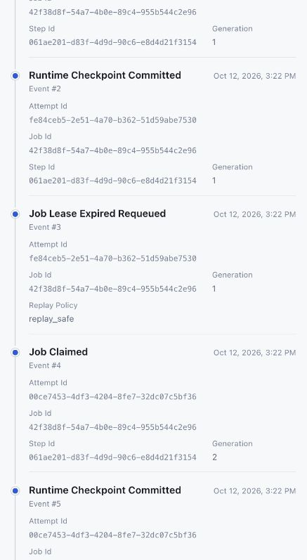

# Checkpoint D local process recovery evidence

**Status:** PASS (local controlled PostgreSQL 17 fixture)  
**Run date:** 2026-10-12  
**Scope:** This evidence covers database-backed queue and lease recovery only. It does not claim hosted execution, model use, GitHub activity, or external side-effect guarantees.

## Reproduction

The test requires a disposable loopback PostgreSQL 17 server and an
administrative connection URL for a database named `continuum_checkpoint_d_test`.
It creates and removes the runtime roles and private schemas. Run it on a
separate PostgreSQL server from other destructive runtime integration tests,
because those fixtures also create and remove cluster-wide roles.

```sh
CONTINUUM_CHECKPOINT_D_TEST_DATABASE_URL='postgresql://postgres:<password>@127.0.0.1:55484/continuum_checkpoint_d_test' \
  make test-target TARGET=tests/integration/test_runtime_demonstration.py
```

Observed result: **2 passed** on PostgreSQL 17.11. The test uses real subprocess
workers, `QueueService`, `RuntimeRecoveryService`, `TransitionService`, a
dedicated `continuum_runtime` login, and the T12 run/event API.

## SIGKILL recovery

The gen1 worker claims a replay-safe job, commits an attempt checkpoint, and
blocks on a parent-controlled pipe with no transaction open. The parent sends
`SIGKILL` and confirms the process has exited with the SIGKILL wait status
before reading PostgreSQL. The gen1 checkpoint row and payload digest remain
present after process death.

The fixture then moves only that row's lease expiry to one second before
PostgreSQL's `clock_timestamp()`. This is a test-only way to avoid sleeping for
the production 60-second lease; the database clock and recovery code remain
real. `RuntimeRecoveryService` records `job.lease_expired_requeued`, gen2 claims
the job, reloads gen1's checkpoint with the owning principal, recalculates and
checks its SHA-256 digest, and derives its accepted result from the persisted
checkpoint payload. The test verifies there is exactly one accepted result and
that its generation and attempt belong to gen2. Gen1 has no accepted result.

## SIGSTOP stale-worker rejection

The second gen1 worker commits its checkpoint, reports the PID of its idle
PostgreSQL backend, and waits on its pipe. The parent sends `SIGSTOP` and checks
the process state with `ps`. It also verifies that the backend is `idle`, has no
active transaction, and holds no PostgreSQL locks.

The test ages the lease using the same controlled database-time update,
recovers the job, and has gen2 claim and commit a checkpoint. The parent then
sends a resume command and `SIGCONT`. The stale gen1 worker attempts both a
checkpoint write and a final transition. Each operation receives `LeaseLost`;
the stale checkpoint is absent. Gen2 reloads and validates gen1's earlier
checkpoint, commits the accepted result, and is the only generation recorded
in `accepted_results`.

## Timeline and audit evidence

The test reads each final snapshot and ordered event page through the T12 API.
The timeline includes `job.claimed`, `runtime.checkpoint_committed`,
`job.lease_expired_requeued`, generation-2 `job.claimed`, and
`activity.result_accepted`. The paused-worker timeline also includes
`runtime.stale_write_rejected` after the parent has observed both `LeaseLost`
responses. The local test observer writes the checkpoint and rejection audit
events only after verifying their corresponding database facts. The worker
does not write these observer events. Event sequence continuity and the final
`waiting_credentials` snapshot are asserted.

## Optional loopback visual review

To preserve both synthetic timelines for review, prepare a private directory
under `/tmp` with mode `0700`, then set it as `CONTINUUM_CHECKPOINT_D_RETAIN_PATH`
for the test command. The fixture leaves the isolated database at the current
migration and writes a mode-`0600` runtime URL and run-owner metadata into that
directory. Do not copy or print the runtime URL.

After the test succeeds, serve those records through the explicitly local
wrapper:

```sh
uv run --locked --python 3.13 python scripts/serve_checkpoint_d_visual.py /tmp/continumm-checkpoint-d/visual
```

The wrapper binds only to `127.0.0.1:8013`, checks the retained PostgreSQL URL
uses the local `continuum_runtime` role, and injects fixed test principals for
the two synthetic runs. It removes inherited `CONTINUUM_*` settings before
constructing the app. It is a review tool for this disposable fixture, not an
authentication option for the product.

After review, stop the wrapper and its dedicated PostgreSQL server, then remove
the private directory and the database cluster. The retention option is absent
by default; ordinary test runs downgrade the schema, drop test roles, and clean
the fixture database.

## Rendered review

The loopback browser displayed the seven-event paused-worker trace, including
generation-2 checkpoint progress, the observed stale-write rejection, and the
accepted result. The current run status and live SSE connection were verified.
The image below captures part of that controlled test timeline, showing the
generation-1 checkpoint and recovery into generation 2.



All temporary apps, PostgreSQL clusters, credentials and retained fixture files
were removed after verification. The committed screenshot contains synthetic
fixture identifiers only.
