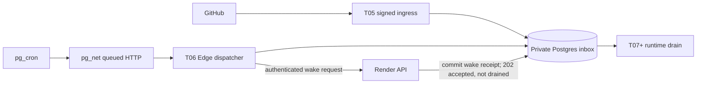

# T06 work-triggered wake design and hosted setup

**Status:** T06 local implementation and verification complete; hosted setup remains NOT RUN.  
**Depends on:** T05's committed private inbox contract (`20261011_01`).  
**Scope:** wake dispatch plumbing only. T06 does not parse GitHub commands or execute jobs.

The plan's §4.4 requires work-triggered backend wakes, persistent backoff, and a last successful drain time. §5 makes PostgreSQL the authority for durable state, while §9.6 requires the webhook inbox to commit before GitHub receives an acknowledgment. T06 joins those boundaries without claiming that a wake processed work.

## Current composed worker

The historical T06 receipt-only contract below remains the default when
`CONTINUUM_ENABLE_WAKE_WORKER=0`. Migration `20261022_31` and the opt-in
[bounded wake worker](bounded-wake-worker.md) now add actual inbox consumption,
due-job recovery and bounded workflow execution. Use that document for the
current worker role, states, completion rules and remaining qualification gaps.
Historical T06 fixture results do not prove the composed worker in hosting.

## Chosen boundary

Use Supabase `pg_cron` plus `pg_net` on a five-minute tick. In one short database transaction, the scheduled database function checks for an unconsumed T05 inbox row and a clear capacity/backoff/lease gate, claims a monotonically increasing generation, creates a short-lived one-use dispatch ticket bound to that generation, and queues an Edge request containing only that ticket. If there is no actionable delivery, it does not queue an Edge or Render request. The Edge Function consumes and validates the ticket and rechecks the gate before calling Render. Runtime jobs, expired leases, and cleanup are later extensions; add each predicate only when its owning task creates the durable state and defines what makes it actionable.

After it consumes the ticket and confirms its generation is current, the Edge Function makes one bounded HTTP request to Render. It does not hold a row lock or database transaction during network I/O. The request contains a wake ID, generation, and a small reason code, never an inbox body or GitHub identifier.

The authenticated backend endpoint commits one durable wake receipt and returns `202 Accepted` only after that commit. Its response has `accepted: true`, `receipt_id` equal to the active `wake_id`, `status: "worker_not_started"`, `drain_status: "not_started"`, and the current nullable `last_successful_drain_at`. The control row retains one active wake ID while its delivery remains pending; retries after backoff use that same wake ID and a new current generation. The backend first rejects a stale generation, then adopts an existing receipt with the same wake ID and reason. Reuse with a conflicting reason/version returns `409`. This is a receipt that a wake request was saved, not proof of command handling or job execution.

Expose the drain watermark through a read-only authenticated `GET /internal/v1/wake/status` response containing only `last_successful_drain_at` and the active receipt's bounded status. The same narrow wake token may call this route; it grants no other operator or runtime authority. At T06 the timestamp is null. The future runtime completion transaction is the only writer, and status reports the database value rather than deriving it from health, HTTP acknowledgments, or request acceptance.

T06 has no runtime job worker or command processor. The receipt remains pending until a later runtime task consumes it. T07+ will own job execution and fenced completion; T35 owns GitHub command interpretation. Until those tasks define and commit a completed drain, `last_successful_drain_at` remains null. Neither an HTTP 200, a dispatcher tick, nor a 202 receipt may set it. Treat an unexpected HTTP 200 as a protocol failure; require the documented 202 receipt body.

If the receipt store is unavailable or the commit result is uncertain, the endpoint returns a retryable failure and never reports acceptance. A later request with the same wake ID resolves whether the earlier transaction committed. If the receiver is not configured or the receipt schema is unavailable, it returns `503` with the stable `worker_not_started` error code rather than placeholder success.

## Durable dispatch contract

T06 adds a nullable `consumed_at` marker and a narrow index to the T05 inbox row; null means pending until the future command consumer owns and commits consumption. Preserve T05's column-limited ingress `INSERT` grant: the new column defaults to null, the ingress function continues naming only its raw delivery columns, and T06 does not widen that grant. The wake role can read the pending marker but cannot update the inbox. T35 owns the consumer write. Do not add a generic queue or a duplicate sidecar marker. A per-row `available_at` field is not needed for T06 because the dispatcher has one durable global `next_attempt_at`; add a per-row due time only if its future owning task needs one. The wake role checks only `EXISTS (... WHERE consumed_at IS NULL)` and never selects raw payloads.

T06 also needs a private, bounded dispatch-control record with one database-clock-based generation, active lease/expiry, active wake ID, persisted `next_attempt_at`, failure count, last dispatch response category, last accepted time, nullable `last_successful_drain_at`, and a known-capacity hold. Keep at most one outstanding receipt keyed by active wake ID, with accepted time and an explicit pending drain state; retries with a later generation adopt that receipt instead of inserting another. Add a private one-use dispatch-ticket record with ticket ID, secret digest, bound generation/attempt ID, expiry, and consumed time. Generate a random short-lived raw ticket, put it only in the single queued request body, and persist only its digest and validation state. The Edge Function passes the ticket to a narrowly granted database function that checks digest, expiry, generation, actionability, capacity, and backoff and consumes it atomically. Do not turn these tables into a general queue.

The generation is a fencing token. Claiming and ticket creation are one short transaction: lock the singleton control row, recheck actionability and current capacity/backoff, increment the generation, create a unique attempt/ticket with a short expiry, set the expiring lease, and enqueue the Edge call. `pg_net` starts the HTTP request only after this transaction commits. The Edge Function atomically consumes the one-use ticket through a narrowly granted database function, confirms its bound generation is still current, and rechecks the actionability/capacity/backoff gate. Ticket replay or expiry cannot create a second valid attempt. After the Edge-to-Render HTTP response, update backoff or contact status in another short transaction only if the generation and lease owner still match. A stale invocation cannot overwrite a newer attempt. The backend checks the same generation before adopting/inserting a receipt. Same-wake retries are idempotent even when the current generation changes; stale generations remain rejected.

The initial actionability predicate is `T05 inbox.consumed_at IS NULL`, which T06 adds without changing the immutable raw delivery fields. T06 reads that predicate; it does not inspect payloads, set `consumed_at`, or declare deliveries processed. T35 owns command interpretation and the consumer that eventually commits the marker.

The dispatcher checks the known-capacity hold before claiming a wake. A hold is authoritative only when written by its future quota/capacity owner or by an operator recording a verified suspension. T06 does not call Render's control plane or infer a quota state from an ambiguous timeout. When suspension is unknown, persist ordinary backoff and leave the work pending. A local test may seed a capacity-hold fixture to prove the skip path; it is not hosted evidence.

Use a persisted exponential retry delay with jitter and a cap for failed/unknown calls. After an accepted-but-still-pending receipt, set a longer bounded re-wake cooldown; the five-minute SQL schedule only evaluates whether that due time has arrived. A DB-unavailable call cannot persist a new backoff; it returns failure and waits for the next scheduled tick. Avoid in-memory retry loops. Record the exact HTTP category, not credentials, request bodies, or arbitrary provider response text.

The dispatch role is read-only on the inbox and may update only its own dispatch-control fields through fixed-search-path functions. The backend receiver login may invoke the receipt/status functions and has no direct table access. No Edge role may mark a receipt drained or update `last_successful_drain_at`; that write belongs to the later runtime completion transaction. Keep the schema outside Data API exposed schemas and inspect effective privileges, including inherited `PUBLIC` privileges.

## Credentials and HTTP behavior

Keep these responsibilities separate:

| Component | Credential and permitted authority |
|---|---|
| T05 ingress Edge Function | Its existing GitHub webhook secret and `continuum_ingress` database credential; receives and stores signed deliveries only. |
| T06 wake Edge Function | A new least-privilege `continuum_wake` database credential for the ticket-consume/result functions, plus a dedicated `CONTINUUM_WAKE_BACKEND_TOKEN` to call only the backend wake route. No GitHub App, model, Vercel, or sandbox credentials. |
| Backend wake receiver | `CONTINUUM_WAKE_RECEIVER_DATABASE_URL` uses a separate `continuum_wake_receiver` login; `CONTINUUM_WAKE_BACKEND_TOKEN` accepts only the wake and read-only status routes. Both variables are required; the receiver defaults to disabled. |
| Supabase scheduled call | A short-lived, one-use database-issued ticket bound to one generation/attempt; no reusable credential, backend wake token, or database URL in `pg_net`. |
| Render backend | The same dedicated wake token in its secret environment and its existing database connection. It accepts the token only on the wake and read-only wake-status routes. |

Use the `Authorization: Bearer …` header for the Edge-to-Render token, compare it in constant time, rotate it through both secret stores, and never put it in a URL, SQL schedule definition, `pg_net` request, receipt row, response, or log. The route accepts only a small strict JSON schema and has no user, GitHub, model, sandbox, or arbitrary URL authority.

Supabase's current `pg_net` documentation says `http_post` queues the request until transaction commit and returns a request ID before the network request runs. Its request queue retains URL, headers, and body, and Supabase warns that direct database logins with `pg_net` access can read queued headers. Therefore the scheduled Postgres-to-Edge request carries only a short-lived, one-use ticket; it must never carry the private Render wake token, a database URL, or a secret Supabase key. `verify_jwt = false` is needed for this function because the scheduled call has no user JWT; the handler's database ticket-consumption step is its first-hop authentication. A database login that sees the queued raw ticket can at most race to consume that single authorized attempt before expiry; the digest check, one-use consumption, generation fence, actionability check, and persisted backoff still apply. The function reveals no inbox data and cannot issue arbitrary backend requests.

The five-minute cron record proves only that Postgres attempted to enqueue an Edge HTTP request. It does not prove Edge execution or Render response. The Edge Function records a dispatch response only after its own bounded `fetch` observes it. The backend receipt is accepted only after PostgreSQL commit. Render Free wakes when it next receives an HTTP request, with a documented cold start of about one minute; its docs do not promise that a request to a monthly-suspended service can wake it or guarantee the exact response timing. Keep the Edge request deadline below Supabase's current 150-second Free wall-clock limit and leave time for database commits. A timeout after the backend may have committed is an unknown outcome: retry the same wake ID after persisted backoff and adopt the original receipt if present.

Render Free service suspension, Supabase project pause, quota restriction, database unavailability, and an ordinary sleeping process are different conditions. An asleep service can be triggered by HTTP; a Render service suspended after exhausting a monthly allowance cannot be awakened by this route. Supabase currently reports `540` for a paused project and `402` for some quota restrictions. These failures leave inbox rows and wake receipts pending. They do not update drain time. Do not add paid fallback or an external keepalive.

The checked-in operator template is [wake-dispatch.sql](../supabase/cron/wake-dispatch.sql). Replace only the public Supabase project ref in its Edge Function URL, then schedule it as the trusted database operator. It invokes `issue_dispatch_ticket()` and queues the returned one-use ticket only; an empty result emits no request. The job's `pg_net` request ID means queued, not Edge or backend success. The SQL was not run locally because the disposable PostgreSQL 17 fixture has no `pg_cron`/`pg_net`; it has also not been run against hosted Supabase.

The timeout layers are bounded separately: Edge database acquire/query operations are capped at 8/6 seconds, the Edge-to-backend request including receipt-body parsing is capped at 100 seconds, and the `pg_net` HTTP request is capped at 140 seconds, below the documented 150-second Edge Free wall limit. Dispatch ticket/lease validity is 120 seconds from the database issue time. Every backend receipt and Edge outcome checks the active attempt, generation, and unexpired lease after taking the required row lock. If scheduling delay or a cold start carries a callback past that lease, it is rejected as stale and cannot update the current outcome or report a drain; the next due tick can issue a new generation for the same coalesced wake ID.

The five-minute database/Edge check is itself periodic database activity. Supabase's Free-project pause guide says that a few user database requests per day can be enough to avoid an inactivity pause; the provider does not document whether this exact `pg_cron`/Edge pattern counts the same way. The dispatcher does not send idle requests to Render, but the schedule may keep the Supabase project active. Verify this behavior and its account impact before treating the selected Free pause behavior as preserved.

## Local proof after implementation is authorized

Use the actual T05 inbox contract and a disposable PostgreSQL 17 database. The local integration now drives the TypeScript Edge handler to a local FastAPI receiver backed by the real `continuum_wake_receiver` role; its test fetcher rewrites the fixed HTTPS fixture origin to loopback. Do not inject a command processor or fake a business drain. The deterministic fixture verifies:

1. Seed one unconsumed synthetic inbox delivery and observe one claimed generation and one authenticated request.
2. Verify a missing, expired, replayed, or stale one-use ticket cannot pass the Edge Function's database validation; a database-visible ticket can authorize only its single fenced attempt.
3. Verify no inbox payload or GitHub ID leaves the Edge dispatcher.
4. Verify an idle inbox, a live lease, persisted backoff, and a seeded known-capacity hold enqueue no Edge request and send no Render request.
5. Run two dispatcher invocations concurrently; only the current generation may record the request/receipt outcome.
6. Inject HTTP 5xx, timeout, lost response after commit, and database failure. Confirm persisted backoff where the DB is available; an uncertain receipt is resolved by the same wake ID.
7. Confirm an accepted response requires a committed wake receipt and reports `drain_status: "not_started"`; both inbox `consumed_at` and `last_successful_drain_at` stay null.
8. Confirm 200 without the receipt schema, an invalid backend wake token, a stale generation, and a conflicting duplicate never report success.
9. Confirm the ingress login cannot write the new consumed marker and Edge/receiver logins cannot read unrelated application data, access private tables directly, or write drain-completion state. Hosted rollout must still inspect effective `PUBLIC`/membership grants, especially `pg_net` queue access.

The local PostgreSQL 17 integration covers the database ticket fences, lock-wait expiry, backoff/capacity hold, and explicit T06 downgrade/re-upgrade. It also confirms that the accepted receipt leaves inbox `consumed_at` and the drain watermark null. The hosted pg_cron/pg_net schedule, Supabase role grants, Render cold start, capacity suspension behavior, and provider usage remain NOT RUN.

An injected HTTP client or SQL fixture is test plumbing only. It must not claim commands or jobs were processed. When the later runtime drain is built, its owning integration test must separately prove that a committed bounded drain advances `last_successful_drain_at`.

## Hosted setup (not performed)

No Supabase project, Render service, GitHub App, scheduled job, wake token, hosted migration, or hosted function is configured in the current workspace. Use this procedure only after the T05 inbox schema is settled, implementation is authorized, and the owner has the accounts.

1. Recheck current Supabase and Render plans, quotas, payment/overage state, project region, and the operator's ₹1,000/month ceiling. Do not add a card, upgrade, or enable paid fallback.
2. Apply the reviewed T06 migration using the separate migration credential. Keep the wake schema private and verify the Edge role's effective grants; keep T05 ingress and T06 wake credentials distinct.
3. Provision a high-entropy wake token in the Supabase Edge secrets and Render environment. Do not set it in a shell argument, cron SQL text, Git, this file, or request logs.
4. Deploy the dispatcher Edge Function with the narrow database connection and a fixed Render origin/path. Configure `pg_cron`/`pg_net` to carry only the DB-issued, one-use ticket in its body; never use `sb_secret_…`, `service_role`, the backend wake token, or a database credential in `pg_net` headers or body.
5. Create one five-minute `pg_cron` job. Verify its row in `cron.job` and inspect `cron.job_run_details`; remember that a successful job row can mean only that `pg_net` accepted a queued request.
6. Insert one synthetic, signed delivery through the deployed T05 ingress or a controlled fixture. Verify one bounded wake request, a Render receipt row committed before `202`, and a still-pending drain status. Repeat the same wake ID to prove duplicate adoption. Verify the inbox delivery remains unconsumed and `last_successful_drain_at` remains null.
7. Exercise idle, active-lease, backoff, known-capacity-hold, bad-token, Render-asleep, Render-suspended, Supabase-unavailable/paused, and response-lost-after-commit cases where the provider state permits. A suspended resource cannot be made to pass by upgrading it.
8. Record provider usage before and after, cron/Edge invocation details, redacted request/receipt IDs, statuses, and cleanup in [T06 hosted evidence](evidence/t06-hosted.md). Leave the report `NOT RUN` until hosted observations exist.

## Official references

- [Supabase: Scheduling Edge Functions](https://supabase.com/docs/guides/functions/schedule-functions) — `pg_cron` + `pg_net` schedule pattern and Vault example.
- [Supabase: pg_net async networking](https://supabase.com/docs/guides/database/extensions/pg_net) — queue semantics, returned request IDs, and response retention.
- [Supabase: database roles and inherited privileges](https://supabase.com/docs/guides/troubleshooting/custom-role-inherits-privileges-that-were-not-explicitly-granted-ddaa1c) — `PUBLIC` grants and least-privilege role checks.
- [Supabase: database roles can read pg_net request headers](https://supabase.com/docs/guides/troubleshooting/database-roles-can-read-request-headers-queued-by-pg_net-ad6357) — queued request URLs, headers, and bodies.
- [Supabase: securing Edge Functions](https://supabase.com/docs/guides/functions/auth) and [authorization headers](https://supabase.com/docs/guides/functions/auth-headers) — service-to-service auth and `verify_jwt` behavior.
- [Supabase: function secrets](https://supabase.com/docs/guides/functions/secrets) — deployment secret storage.
- [Supabase: Free project pausing](https://supabase.com/docs/guides/platform/free-project-pausing) and [HTTP status codes](https://supabase.com/docs/guides/troubleshooting/http-status-codes) — inactivity pausing and paused/quota responses.
- [Supabase: Edge Function limits](https://supabase.com/docs/guides/troubleshooting/edge-function-cpu-limits) — current Free wall-clock limit.
- [Render: Free services](https://render.com/docs/free) and [FAQ](https://render.com/docs/faq) — cold start, inbound HTTP wake, and monthly suspension behavior.
